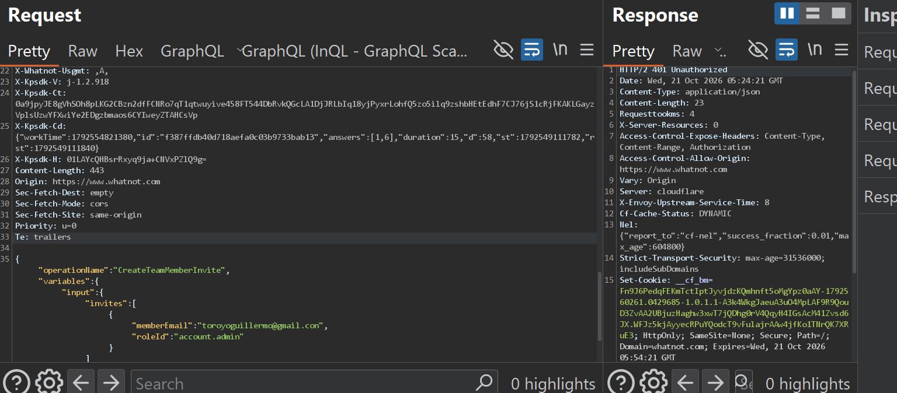
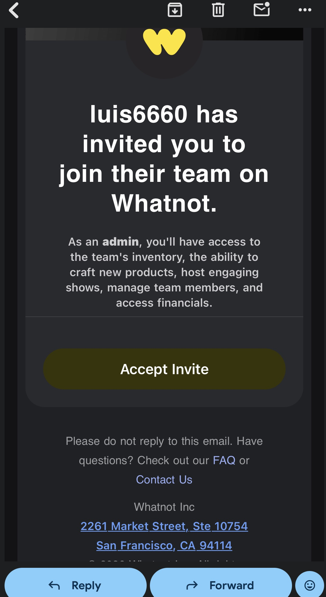
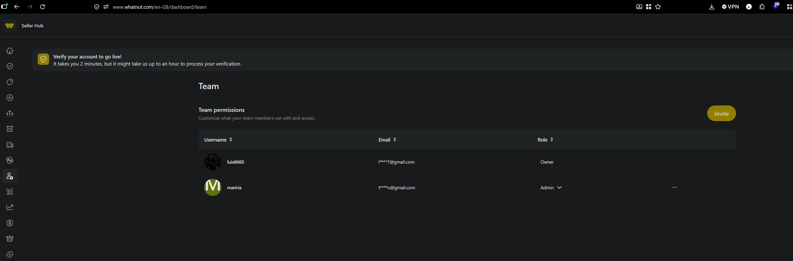
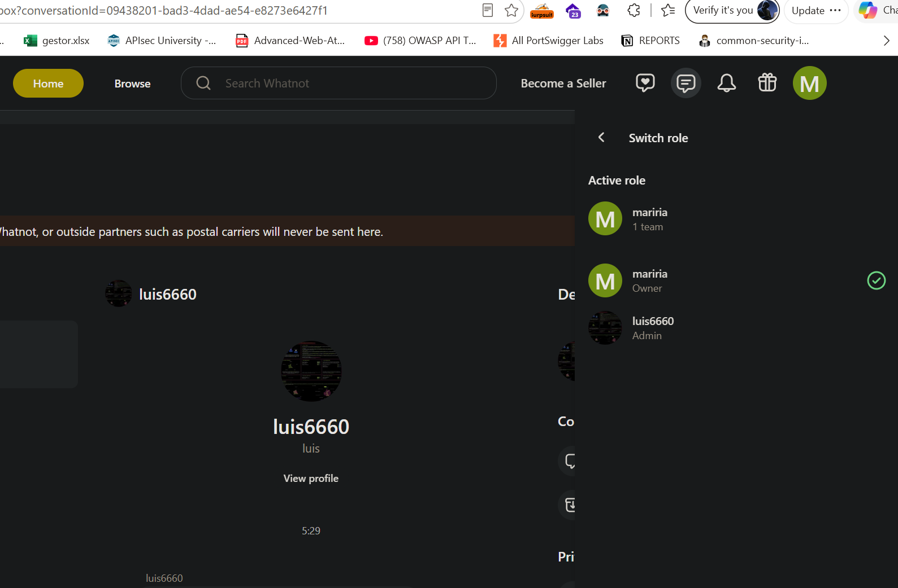
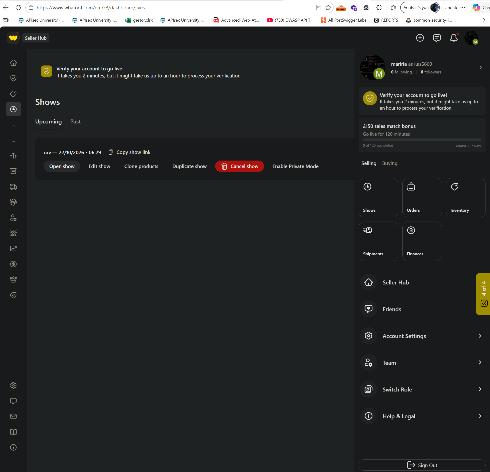
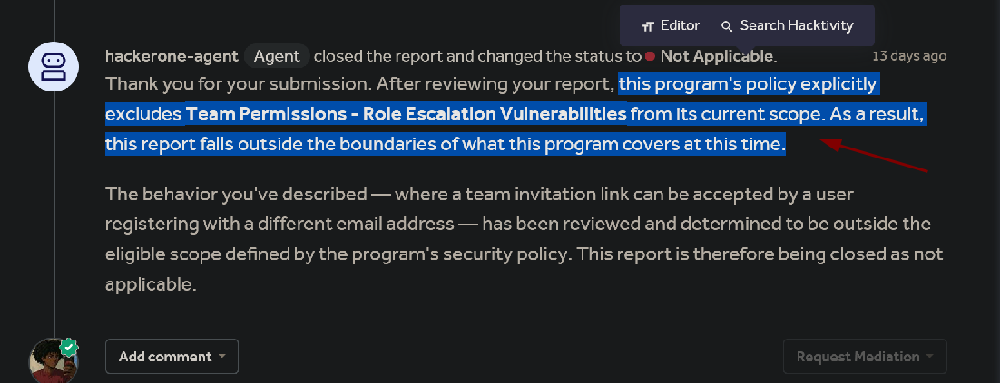

## Target

Whatnot is a livestream shopping and auction platform where sellers can build teams with assigned roles (e.g. Admin) to help manage their account and live shows.

## Summary

Whatnot's team invitation flow appears to allow an invitation intended for a specific email address to be accepted by a newly registered account using a different email address. During testing, the team owner invited a user by email and assigned the Admin role. The invitation link was copied and opened in a separate, isolated browser session. A new Whatnot account was then registered using a different email address through that same invitation link. The new account successfully joined the team and received Admin access. In the owner's team list, the new account's name appeared alongside the original invitee's email address.

This may indicate that the invitation is not strictly bound to the intended recipient's identity. The issue should be evaluated against Whatnot's intended invitation model, since public documentation does not explicitly clarify whether invitations are transferable.

## Vulnerability Details

| Field | Value |
|-------|-------|
| **Type** | Broken-Access-Control |
| **Severity** | High |
| **Status** | Reported - N/A (Out of Scope) |

- **Flow affected:** Team invitation acceptance
- **Expected behavior:** An invitation sent to a specific email address should only be acceptable by an account verified under that same email address.
- **Observed behavior:** The invitation link itself appears to grant membership and role privileges regardless of which email address completes the registration/acceptance flow; i.e. the link behaves as a bearer token rather than being bound to the invited identity.

## Steps to Reproduce

1. Log in to Whatnot using the team owner's account (Luis).
2. Invite Guille by entering Guille's email address and assigning the Admin role.

3. Copy the generated invitation link.
4. Open the invitation link in a separate browser or isolated browser session.

5. Register a new Whatnot account named María using an email address different from the invited recipient's email.
6. Complete the registration and invitation flow.
7. Observe that María successfully joins the team.
8. Return to Luis's account and inspect the team member list.
9. Observe that María's name appears alongside Guille's invitation email address.

10. Verify that María has the Admin role and can access the administrative functionality available to that role.
11. Switch from Maria to the owner account Luis

12. Now the attacker Maria can control de owner account: delete, create, invite: e.g; post, lives, etc.

> The invitation link functioned as a bearer credential: possession of the link — not verification of the invited email, was sufficient to claim the role attached to it.

## Actual Result

A newly registered account using a different email address was able to accept the invitation. The team member list displayed the new account's name paired with the original invitee's email address. The new account received the Admin role and was able to use **Switch role** to access the owner's account context, performing certain actions — including deleting the owner's live show. Some functionality remained restricted by the team role (e.g. certain account settings). Notably, the owner account itself did not display a "Switch role" option; the reason for this asymmetry is unknown.

## Expected Result

If invitations are intended to be bound to a specific email address, Whatnot should reject acceptance by an account whose verified email does not match the intended recipient. The system should not create team membership or grant the assigned role to a mismatched account.

## Impact

If this behavior violates Whatnot's intended invitation model, anyone who obtains an invitation link intended for someone else could claim it with their own account and inherit the privileges assigned by the owner. For an Admin-level invitation, this could allow unauthorized administrative actions affecting the owner's team and live shows — the ability to delete a live show was directly observed, though this may be an intended permission of the Admin role itself.

**This report does not claim** account takeover, credential compromise, access to payout details, or access to confidential information beyond what was directly observed.

## Suggested Remediation

- Bind each invitation to the intended recipient's verified identity, if invitations are meant to be email-bound.
- Validate the authenticated account's verified email against the invitation's recipient email before accepting.
- Reject mismatched accounts without creating membership or granting any privileges.
- Ensure the displayed member identity, email address, and assigned role all consistently refer to the same account.
- Ensure revoked or expired invitations cannot be accepted.

## Disclosure Timeline

- Reported to Whatnot via HackerOne
- Closed by HackerOne triage: **Not Applicable**, program policy explicitly excludes "Team Permissions, Role Escalation Vulnerabilities" from scope
- Status: Closed, out of scope (policy exclusion, not a technical dispute of the finding)

> This finding was closed as **Not Applicable** solely because the program's policy explicitly excludes Team Permissions / Role Escalation vulnerabilities from scope, not because the behavior itself was disputed or found to be working as intended. It is shared here for educational purposes and to document the finding.
>
> 
