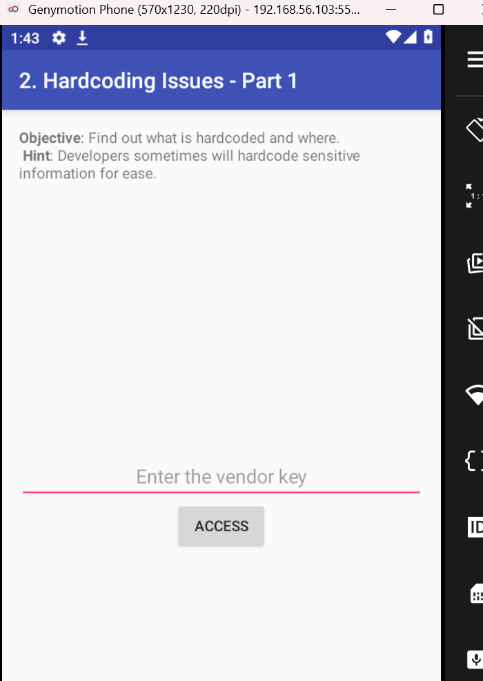
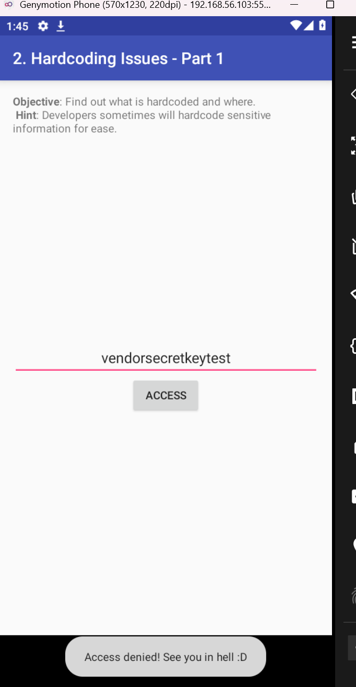
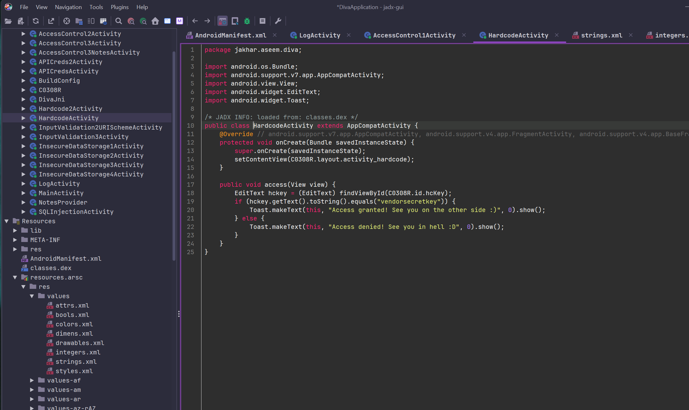
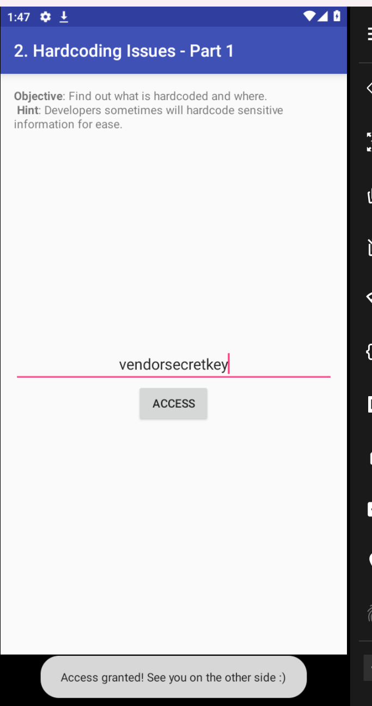
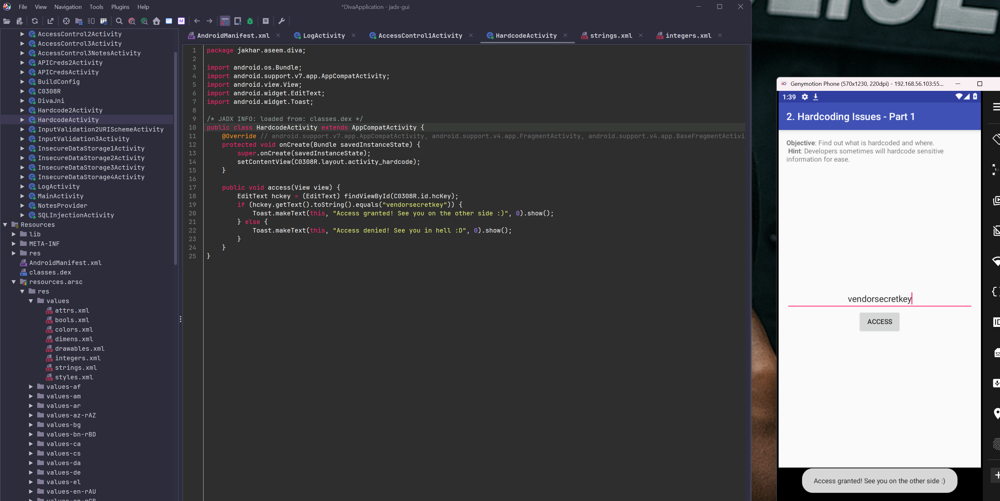

## Objective

Challenge 2 of **DIVA (Damn Insecure and Vulnerable App)** asks you to find out what is hardcoded in the app and where.

> **App hint:** Developers sometimes will hardcode sensitive information for ease.

## Environment

- Genymotion Phone (570x1230, 220dpi)
- DIVA installed
- jadx-gui for static analysis

## Step 1: Interact with the app

The "2. Hardcoding Issues - Part 1" screen asks for a **vendor key** to gain access:



Without the correct key, the **ACCESS** button returns "Access denied! See you in hell :D".



## Step 2: Pull the APK

```bash
adb shell pm path jakhar.aseem.diva
adb pull /data/app/jakhar.aseem.diva-X/base.apk diva.apk
```

```
adb shell → opens a command session inside the Android system itself (like having a terminal on the phone).

pm → the Package Manager, Android’s tool for managing installed apps.
path jakhar.aseem.diva → asks the Package Manager where that package’s APK is physically installed (jakhar.aseem.diva is DIVA’s package name, visible in the code as package jakhar.aseem.diva;).

adb pull → copies a file from the device to your PC (the opposite of adb push).
/data/app/jakhar.aseem.diva-X/base.apk → the path you got from command 1 (here X is a placeholder, you need to replace it with the actual number/hash returned).
diva.apk → the name the file will be saved as in your current PC folder.
```

## Step 3: Decompile with jadx

I open `diva.apk` in **jadx-gui** and locate `HardcodeActivity.java`:

```java
public void access(View view) {
    EditText hckey = (EditText) findViewById(C0308R.id.hcKey);
    if (hckey.getText().toString().equals("vendorsecretkey")) {
        Toast.makeText(this, "Access granted! See you on the other side :)", 0).show();
    } else {
        Toast.makeText(this, "Access denied! See you in hell :D", 0).show();
    }
}
```


The vendor key, **`vendorsecretkey`**, is hardcoded directly in the activity's bytecode, compared with a plain `.equals()` check against whatever the user types.



## Step 4: Confirm the finding

Entering `vendorsecretkey` in the app's input field and tapping **ACCESS** returns:

> Access granted! See you on the other side :)






## Why this is a problem

- The key is embedded directly in the compiled APK, which anyone can download, decompile with jadx, and read in seconds, no root or dynamic analysis required.
- The comparison logic itself lives client-side (`hckey.getText().toString().equals(...)`), so even obfuscating the string wouldn't fully solve it: the check should happen server-side.
- A real "vendor key" protecting an API or a partner integration would let an attacker impersonate the app itself once extracted, not just one account.

## OWASP classification

This maps to **M1: Improper Credential Usage** in the OWASP Mobile Top 10 (2024), which covers credentials, API keys, and secrets embedded insecurely in client-side code. It also relates to **CWE-798: Use of Hard-coded Credentials**.

## Mitigation

- Never hardcode API keys, vendor keys, or secrets in client-side code, mobile apps are fully extractable.
- Move sensitive validation logic to the backend, where the client only sends a request and the server holds the secret.
- If a client-side secret is unavoidable, use platform-backed secure storage (Android Keystore) combined with server-side attestation, not a plain string comparison in code.
- Regularly scan release APKs for hardcoded secrets as part of the CI/CD pipeline.

## References

- OWASP Mobile Top 10 2024 - M1: Improper Credential Usage
- OWASP MASTG - Testing for Hardcoded Secrets
- [DIVA - Damn Insecure and Vulnerable App](https://github.com/payatu/diva-android)
