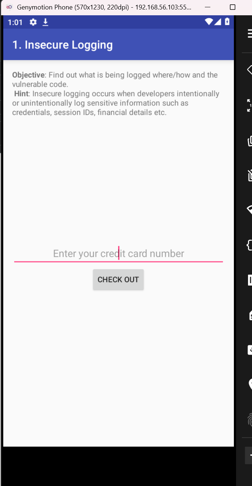
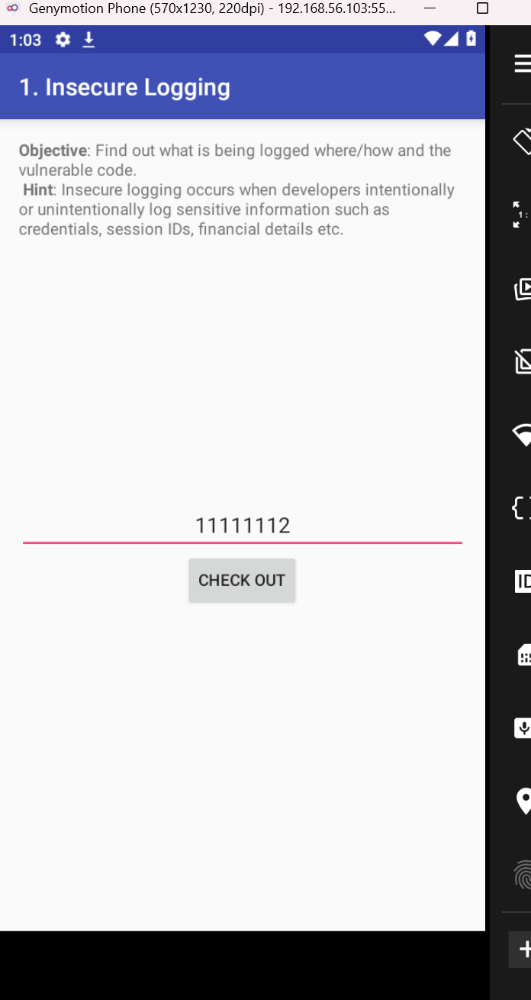
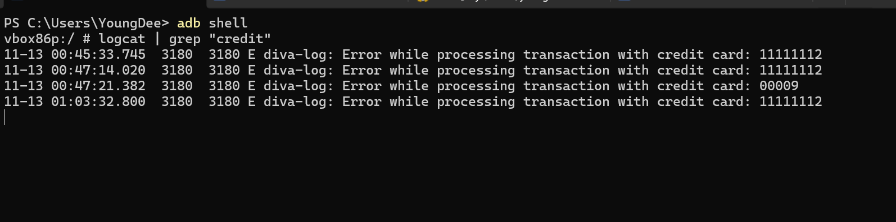
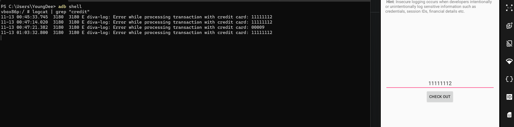
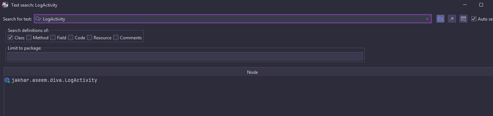
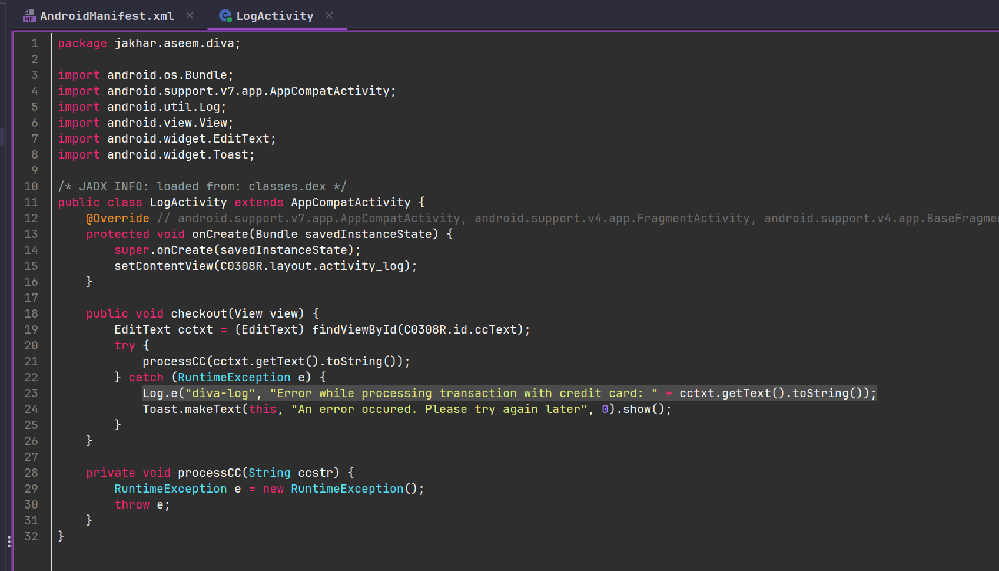

## Objective

Challenge 1 of **DIVA (Damn Insecure and Vulnerable App)** asks you to find out what sensitive information is being logged, where, and which part of the code is responsible.

> **App hint:** Insecure logging occurs when developers intentionally or unintentionally log sensitive information such as credentials, session IDs, financial details, etc.

## Environment

- Genymotion Phone (570x1230, 220dpi)
- DIVA installed
- ADB connected to the device

## Step 1: Interact with the app

The "1. Insecure Logging" screen asks for a credit card number to check out:



I enter a test number (e.g. `11111112`) and tap **CHECK OUT**.



## Step 2: Capture logcat

I open an ADB shell and filter the log by the word `credit`:

```bash
adb shell
logcat | grep "credit"
```


Result:

```
11-13 00:45:33.745 3180 3180 E diva-log: Error while processing transaction with credit card: 11111112
11-13 00:47:14.020 3180 3180 E diva-log: Error while processing transaction with credit card: 11111112
11-13 00:47:21.382 3180 3180 E diva-log: Error while processing transaction with credit card: 00009
```


The credit card number entered is logged **in plaintext** to the system log, under the `diva-log` tag, at `Error` level.

## Why this is a problem

- Android's `logcat` logs can be read by **other apps** that hold the `READ_LOGS` permission (on older Android versions) or by any app with debug/root access.
- In poorly configured production apps, these logs sometimes end up forwarded to **crash reporters** (Crashlytics, Sentry) or **centralized backend logs**, widening who can see them.
- This directly exposes sensitive financial data (the card's PAN - Primary Account Number), which in a real-world app would violate PCI-DSS.

## Code review (optional, if you decompile the APK)

Using `jadx`, you can locate the responsible class, typically something like `LogActivity.java`, where you'll find a direct call similar to:

```java
Log.e("diva-log", "Error while processing transaction with credit card: " + cardNumber);
```




This confirms the issue is a `Log.e()` call with the sensitive value concatenated directly, with no masking or truncation.

## OWASP classification

This maps to **M9: Insecure Data Storage** in the OWASP Mobile Top 10 (2024), since system logs are considered a form of data storage accessible outside the app's direct control. It also relates to **CWE-532: Insertion of Sensitive Information into Log File**.

## Mitigation

- Never log sensitive data (credit cards, passwords, tokens), not even inside error-handling blocks.
- If logging is needed for debugging, gate it behind development-only builds (`BuildConfig.DEBUG`) and strip it from production.
- Mask sensitive values when logging is unavoidable (e.g. show only the last 4 digits).
- Check that no third-party tooling (analytics, crash reporting) is forwarding unfiltered system logs.

## References

- OWASP Mobile Top 10 2024 - M9: Insecure Data Storage
- OWASP MASTG - Testing Logs for Sensitive Data
- [DIVA - Damn Insecure and Vulnerable App](https://github.com/payatu/diva-android)
