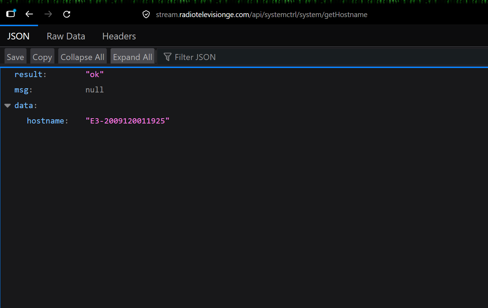
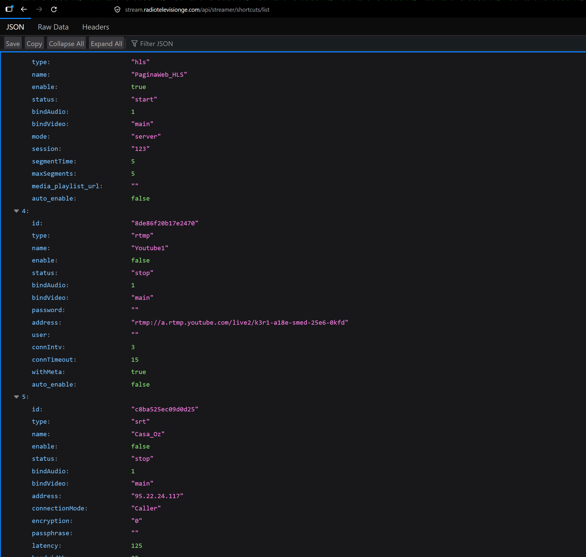

Exploiting a missing auth dependency on a broadcast encoder's management API to read internal network details, the ONVIF admin identity and the station's live YouTube RTMP stream key, and to reach every configuration write route with no session and no CSRF token.
 
## Target
 
`radiotelevisionge.com`: the system belongs to the state broadcaster (radio and television) of a [REDACTED] country

## Summary

An unauthenticated API endpoint on a Kiloview E3 encoder exposed the national broadcaster's YouTube Live RTMP streaming configuration, including its associated stream key.

The exposed credential followed YouTube's standard RTMP stream-key format and was configured to use the encoder's main SDI program feed (`bindVideo: "main"`).

A YouTube RTMP stream key functions as an authentication credential for the channel's live ingest service. Its exposure could potentially allow an unauthorised party to use the broadcaster's streaming identity and attempt to publish content to its live channel.

The investigation confirmed that the streaming configuration was accessible without authentication. Protocol-level connectivity was also tested, but the actual stream key was never transmitted and no publishing attempt was performed.

The issue was handled as a read-only investigation to avoid disrupting the national broadcaster's live streaming operations.


## 1. What is exposed

An unauthenticated API endpoint exposed the national broadcaster's YouTube RTMP streaming configuration.

```json
{
  "id": "8de86f20b17e2470",
  "type": "rtmp",
  "name": "Youtube1",
  "enable": false,
  "status": "stop",
  "bindAudio": 1,
  "bindVideo": "main",
  "user": "",
  "password": "",
  "address": "rtmp://a.rtmp.youtube.com/live2/[REDACTED]"
}
```

| Property | Value |
|:---|:---|
| Ingest host | `a.rtmp.youtube.com/live2` — YouTube standard ingest |
| Key shape | 5×4 characters, 24 characters — exact reported YouTube format |
| Masked key | `k3r1-••••-••••-••••-0kfd` |
| SHA-256 prefix | `f24426ffc0fa4e2084e6e874caf513a5…` |
| Bound to | `bindVideo: "main"` → SDI main program feed |

The SHA-256 fingerprint was calculated locally without printing the complete credential.

**Also exposed:**

- SRT: `102.164.248.126:5000` (active)
- Additional endpoint: `95.22.24.117:1025`
- HLS configuration
- NDI: `239.255.0.0/16`

## 2. Why it's a potential hijack, not just information disclosure

A YouTube RTMP stream key is an authentication credential for a channel's live ingest service.

An unauthorised party obtaining a valid credential could potentially authenticate against the broadcaster's streaming destination and attempt to initiate a broadcast.

Potential consequences include:

- Unauthorised use of the broadcaster's live streaming identity.
- Content injection into a live broadcast.
- Interference with legitimate broadcasting sessions.
- Impersonation of a national broadcaster.
- Reputational damage and potential platform enforcement actions.

Device-side remediation alone does not invalidate an already exposed credential. The stream key must be rotated.

## 3. Step by step

- **STEP 1 (done):** `GET /api/systemctrl/system/getHostname` → `E3-2009120011925`



- **STEP 2 (done):** `GET /api/streamer/shortcuts/list` → RTMP URL and stream key exposed.



- **STEP 3 (documented):** YouTube RTMP destination identified in the exposed configuration.
- **STEP 4 (documented, not executed):** Potential use of the exposed credential to initiate an unauthorised publishing session.
- **⛔ STOP:** Publishing was not attempted because it could put unauthorised test content on a national broadcaster's live channel.

## 4. What an unauthorised publication could produce

| Potential impact | Description |
|:---|:---|
| Channel takeover | Unauthorised use of the broadcaster's live ingest credentials |
| Impersonation | Use of a national broadcaster's streaming identity |
| Content injection | Unauthorised content reaching the audience |
| Broadcast disruption | Conflict with the legitimate streaming feed |
| Platform consequences | Potential channel strikes or enforcement actions |
| Persistent exposure | Credential remains compromised until rotated |

These are potential consequences, not actions performed during testing.

### 4b. Protocol-level verification (executed, key never sent)

| Step | Result |
|:---|:---|
| TCP 1935 → `a.rtmp.youtube.com` | Connected |
| C0/C1 → S0+S1+S2 | 3,073 bytes, version 3, real handshake |
| `connect(app="live2")` without key | Silent close (0 bytes) |
| Dummy-key comparison | Identical silent close |
| `createStream()` | No `_result` |

**Observation:**

The RTMP handshake confirmed protocol connectivity to YouTube's ingest infrastructure.

The tests did not establish an authenticated publishing session or confirm that the exposed credential could successfully publish.

The actual stream key was never transmitted.

The complete stream key has been redacted.

## 6. Why the final step was not executed

**Publishing is the attack.**

Using the exposed credential to initiate a broadcast could have resulted in unauthorised content appearing on a national broadcaster's live channel.

This could have:

- Interrupted a legitimate broadcast.
- Injected unauthorised content into the transmission.
- Impersonated the broadcaster.
- Affected viewers and broadcasting operations.

The final publication step was deliberately not executed.

The triager can independently verify the credential against the broadcaster's YouTube Studio streaming configuration and rotate it without requiring a public test broadcast.

No publication, channel takeover or broadcast disruption was performed.

## 7. Remediation

- **Rotate the exposed YouTube RTMP stream key immediately.**
- Remove direct public access to the encoder management interface.
- Enforce authentication and authorisation on every `/api/` route.
- Apply appropriate authorisation checks to management operations.
- Implement POST protection and CSRF controls where applicable.
- Restrict management access to authorised station infrastructure.
- Update encoder firmware to version 1.30 or later, following vendor guidance.
- Treat all exposed streaming credentials as compromised secrets.
- Review and rotate other potentially exposed credentials.

## 8. Detection

| Detection source | Indicator |
|:---|:---|
| YouTube Live Control Room | Unexpected publishing sessions or another broadcast using the same key |
| Encoder logs | Unexpected reads of `streamer/*` endpoints |
| System management logs | Unexpected `setHostname` or reboot requests |
| Network monitoring | API requests originating from non-station IP addresses |
| Cloudflare / Firewall | Requests to `/api/*` from unauthorised sources |

**Recommended network restriction:**

Block public access to `/api/*` and allow requests only from authorised station infrastructure.
