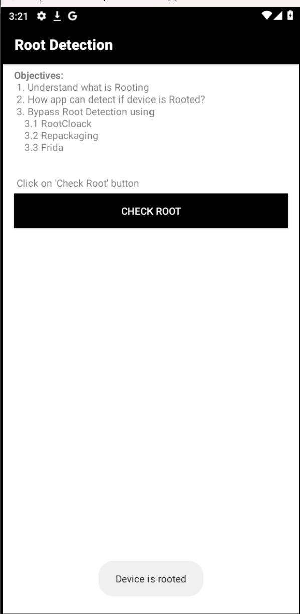
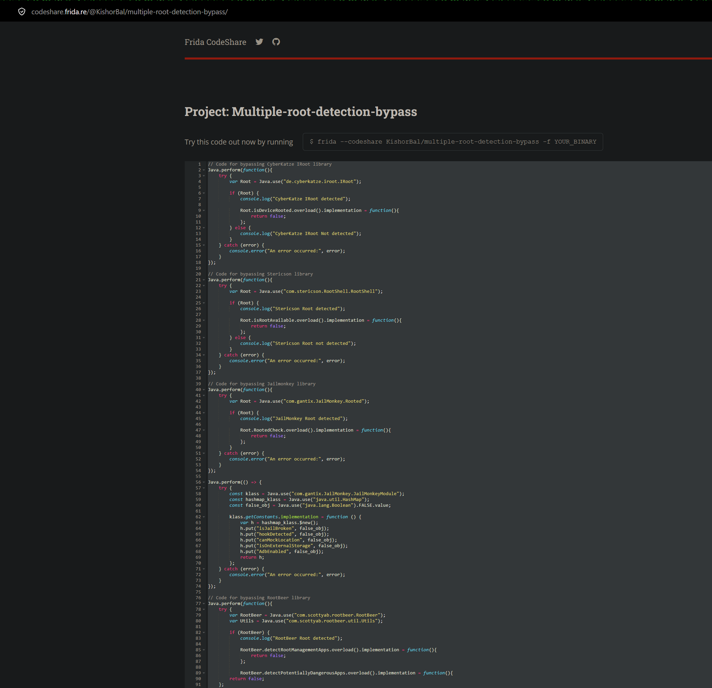
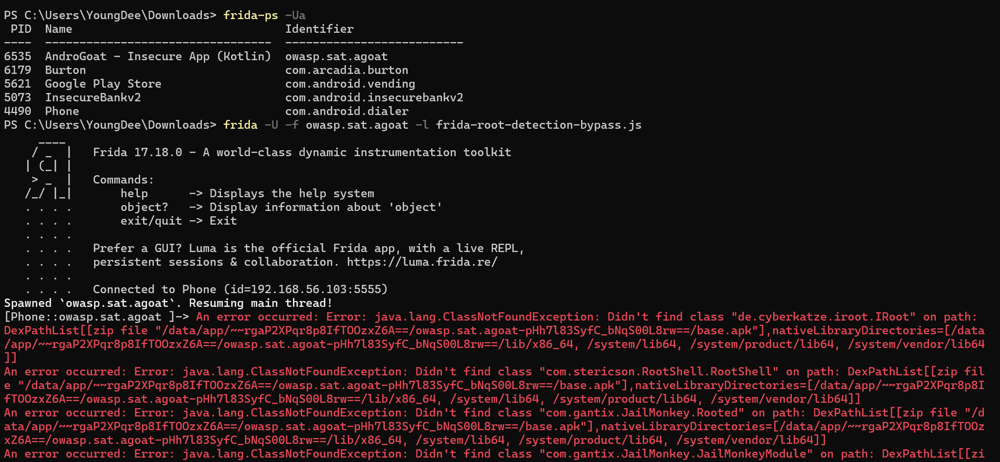
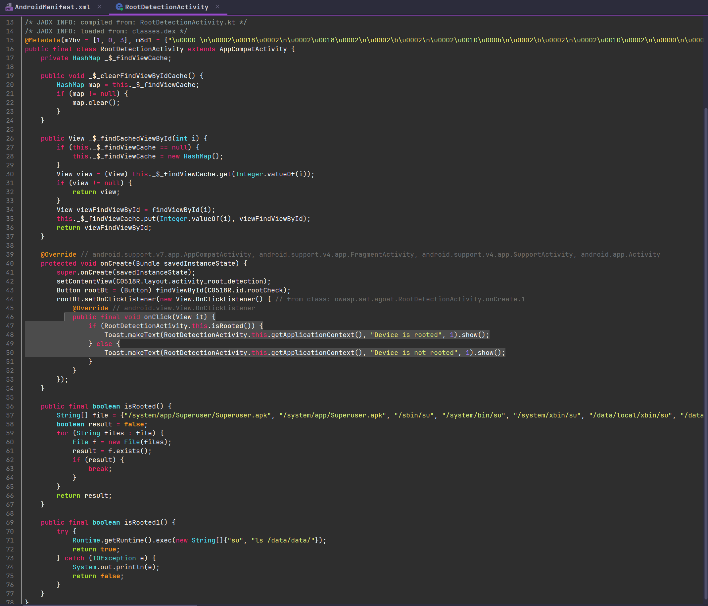
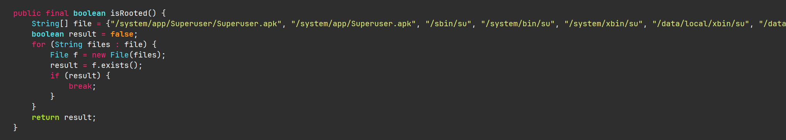
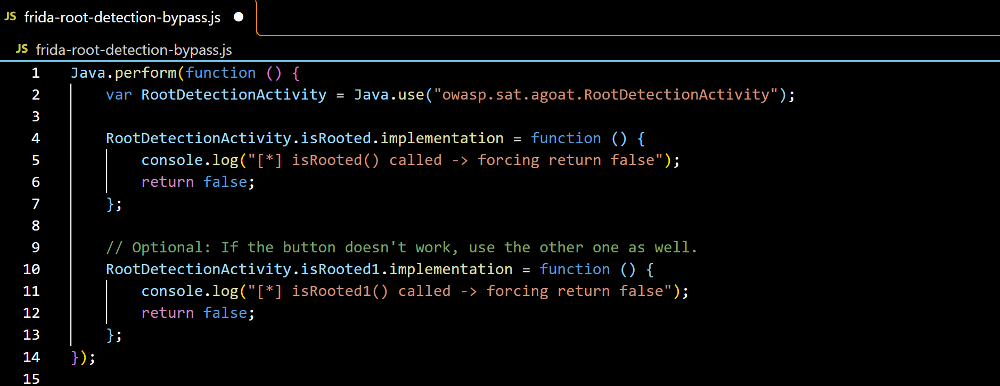
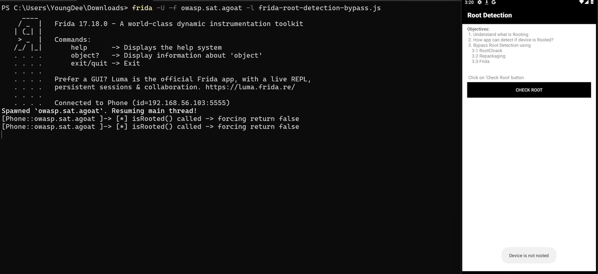

 
## Target
 
[AndroGoat](https://github.com/satishpatnayak/AndroGoat) is OWASP's intentionally vulnerable Android app (Kotlin), built to practice mobile security testing against the OWASP MASTG Top 10 categories. This exercise covers **root detection bypass**, one of the resiliency checks under the MASTG anti-tampering category.
 
## Goal
 
Make the app's "Root Detection" screen report **"Device is not rooted"** on a rooted test device/emulator, by patching the check at runtime with Frida instead of modifying the APK.


 
## Step 1: First attempt; generic bypass script
 
Started with a well-known public script, [`frida-root-detection-bypass.js`](https://codeshare.frida.re/@KishorBal/multiple-root-detection-bypass/), which hooks a long list of **known third-party root-detection libraries** (CyberKatze `IRoot`, Stericson `RootShell`, JailMonkey, RootBeer, etc.):




```bash
// Code for bypassing CyberKatze IRoot library
Java.perform(function(){
    try {
        var Root = Java.use("de.cyberkatze.iroot.IRoot");
        
        if (Root) {
            console.log("CyberKatze IRoot detected");

            Root.isDeviceRooted.overload().implementation = function(){
                return false;
            };
        } else {
            console.log("CyberKatze IRoot Not detected");
        }
    } catch (error) {
        console.error("An error occurred:", error);
    }
});

// Code for bypassing Stericson library
Java.perform(function(){
    try {
        var Root = Java.use("com.stericson.RootShell.RootShell");
        
        if (Root) {
            console.log("Stericson Root detected");

            Root.isRootAvailable.overload().implementation = function(){
                return false;
            };
        } else {
            console.log("Stericson Root not detected");
        }
    } catch (error) {
        console.error("An error occurred:", error);
    }
});

// Code for bypassing Jailmonkey library
Java.perform(function(){
    try {
        var Root = Java.use("com.gantix.JailMonkey.Rooted");
        
        if (Root) {
            console.log("JailMonkey Root detected");

            Root.RootedCheck.overload().implementation = function(){
                return false;
            };
        }
    } catch (error) {
        console.error("An error occurred:", error);
    }
});

Java.perform(() => {
    try {
        const klass = Java.use("com.gantix.JailMonkey.JailMonkeyModule");
        const hashmap_klass = Java.use("java.util.HashMap");
        const false_obj = Java.use("java.lang.Boolean").FALSE.value;

        klass.getConstants.implementation = function () {
            var h = hashmap_klass.$new();
            h.put("isJailBroken", false_obj);
            h.put("hookDetected", false_obj);
            h.put("canMockLocation", false_obj);
            h.put("isOnExternalStorage", false_obj);
            h.put("AdbEnabled", false_obj);
            return h;
        };
    } catch (error) {
        console.error("An error occurred:", error);
    }
});

// Code for bypassing RootBeer library
Java.perform(function(){
    try {
        var RootBeer = Java.use("com.scottyab.rootbeer.RootBeer");
        var Utils = Java.use("com.scottyab.rootbeer.util.Utils"); 
        
        if (RootBeer) {
            console.log("RootBeer Root detected");
            
            RootBeer.detectRootManagementApps.overload().implementation = function(){
                return false;
            };
            
            RootBeer.detectPotentiallyDangerousApps.overload().implementation = function(){
        return false;
    };
    
    RootBeer.detectTestKeys.overload().implementation = function(){
        return false;
    };
    
    RootBeer.checkForBusyBoxBinary.overload().implementation = function(){
        return false;
    };
    
    RootBeer.checkForSuBinary.overload().implementation = function(){
        return false;
    };
    
    RootBeer.checkSuExists.overload().implementation = function(){
        return false;
    };
    
    RootBeer.checkForRWPaths.overload().implementation = function(){
        return false;
    };
    
    RootBeer.checkForDangerousProps.overload().implementation = function(){
        return false;
    };
    
    RootBeer.checkForRootNative.overload().implementation = function(){
        return false;
    };
    
    RootBeer.detectRootCloakingApps.overload().implementation = function(){
        return false;
    };
    
    Utils.isSelinuxFlagInEnabled.overload().implementation = function(){
        return false;
    };
    
    RootBeer.checkForMagiskBinary.overload().implementation = function(){
        return false;
    };

            RootBeer.isRooted.overload().implementation = function(){
                return false;
            };
        } else {
            console.log("RootBeer Root not detected");
        }
    } catch (error) {
        console.error("An error occurred:", error);
    }
});
```


 
```powershell
frida-ps -Ua
frida -U -f owasp.sat.agoat -l frida-root-detection-bypass.js
```
 
Result: a wall of `java.lang.ClassNotFoundException` errors, none of those classes exist in AndroGoat, and the app still reported **"Device is rooted"**. This confirmed AndroGoat doesn't use any of those common libraries; it has its **own custom check**.


 
## Step 2: Decompiling the APK with jadx
 
Opened the APK in `jadx-gui` to read the actual source:
 
1. Expanded the `owasp.sat.agoat` package in the source tree.
2. Found `RootDetectionActivity.kt` (compiled class).
3. Inside `onCreate()`, the **"CHECK ROOT"** button's click listener calls:
```java
if (RootDetectionActivity.this.isRooted()) {
    Toast.makeText(..., "Device is rooted", 1).show();
} else {
    Toast.makeText(..., "Device is not rooted", 1).show();
}
```



 
4. `isRooted()` itself does a simple file-existence check against a hardcoded list of common su/busybox paths:
```java
public final boolean isRooted() {
    String[] file = {"/system/app/Superuser/Superuser.apk", "/sbin/su",
                      "/system/bin/su", "/system/xbin/su", "/data/local/xbin/su", ...};
    boolean result = false;
    for (String f : file) {
        result = new File(f).exists();
        if (result) break;
    }
    return result;
}
```



 
   There's also an unused `isRooted1()` that shells out to `su` via `Runtime.exec()`, but the button only calls `isRooted()`.
 
## Step 3: Writing a targeted Frida script
 
Instead of guessing against generic libraries, hooked the exact class and method found in jadx:
 
```javascript
Java.perform(function () {
    var RootDetectionActivity = Java.use("owasp.sat.agoat.RootDetectionActivity");
 
    RootDetectionActivity.isRooted.implementation = function () {
        console.log("[*] isRooted() called -> forcing return false");
        return false;
    };
 
    // Covers the unused secondary check too, just in case
    RootDetectionActivity.isRooted1.implementation = function () {
        console.log("[*] isRooted1() called -> forcing return false");
        return false;
    };
});
```


 
## Step 4: Running it
 
```powershell
frida -U -f owasp.sat.agoat -l frida-root-detection-bypass.js
```


 
Console output confirmed the hook fired:
 
```
Spawned `owasp.sat.agoat`. Resuming main thread!
[Phone::owasp.sat.agoat ]-> [*] isRooted() called -> forcing return false
```
 
And on the device, pressing **CHECK ROOT** now returned:
 
> **Device is not rooted**

 
## Takeaway
 
Generic "multi-bypass" Frida scripts are a good first try, but they only work when the target app actually uses one of the libraries they cover. When they fail silently (class-not-found errors, no behavior change), the reliable next step is:
 
1. Decompile with jadx.
2. Search for the keywords the check logically must use (`isRooted`, `su`, `/system/xbin`, etc.).
3. Hook the exact class/method found, instead of a library name you're hoping is present.
This same workflow (jadx → find real sink → custom Frida hook) applies to any resiliency check: SSL pinning, emulator detection, debugger detection, etc. not just root detection.
